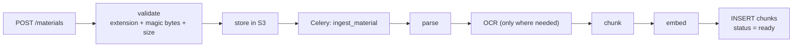
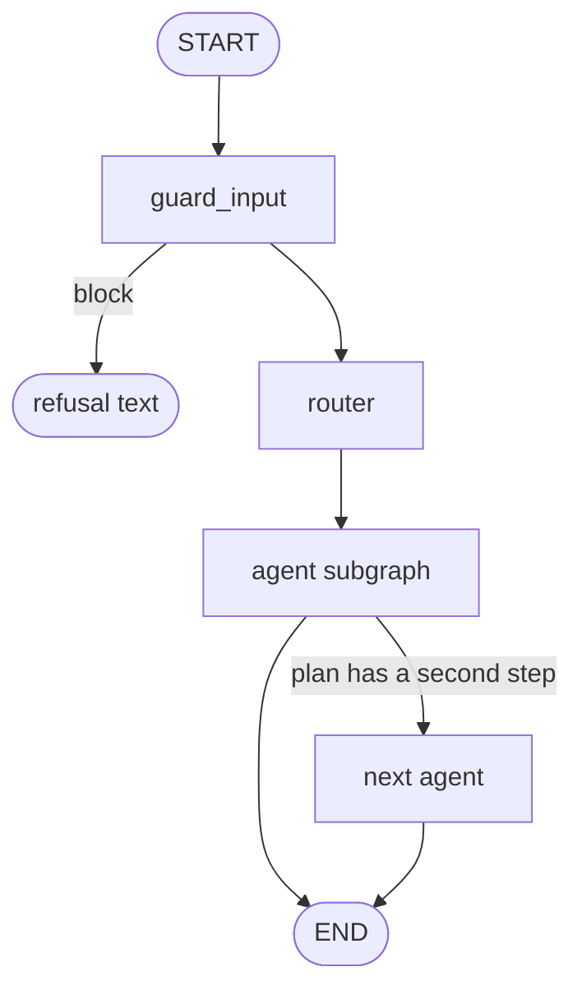

# MindNest AI: technical documentation

This document explains how MindNest AI is built: every module, the algorithms and the arithmetic
behind them, the decisions that shaped the design, and why each technology was chosen over its
alternatives. It describes the code as it is. File names are given so every claim can be checked.

> New to the project? Read the [README](README.md) first.

## Contents

1. [Overview and design principles](#1-overview-and-design-principles)
2. [System architecture](#2-system-architecture)
3. [Code organisation](#3-code-organisation)
4. [Database and multi-tenancy](#4-database-and-multi-tenancy)
5. [Accounts and authentication](#5-accounts-and-authentication)
6. [Ingestion: from file to searchable passages](#6-ingestion-from-file-to-searchable-passages)
7. [Retrieval](#7-retrieval)
8. [The model service](#8-the-model-service)
9. [Chat](#9-chat)
10. [The agent layer](#10-the-agent-layer)
11. [AI safety](#11-ai-safety)
12. [Study features: quizzes, planner, progress, assignments](#12-study-features-quizzes-planner-progress-assignments)
13. [Google sign-in and Calendar](#13-google-sign-in-and-calendar)
14. [Groups, library and admin](#14-groups-library-and-admin)
15. [Evaluation](#15-evaluation)
16. [The web application](#16-the-web-application)
17. [Infrastructure and operations](#17-infrastructure-and-operations)
18. [Testing and quality gates](#18-testing-and-quality-gates)
19. [Why these technologies](#19-why-these-technologies)
20. [Known limits and honest trade-offs](#20-known-limits-and-honest-trade-offs)

---

## 1. Overview and design principles

MindNest AI turns a student's own study material into a private, searchable knowledge base and
builds learning tools on top of it. The scale and shape of the code base:

| Measure | Value |
| --- | --- |
| Python (non-test) | about 27,000 lines |
| Python tests | about 16,000 lines, about 1,000 test functions |
| TypeScript / TSX | about 34,700 lines |
| HTTP endpoints | 200+ across 30 routers, all under `/api/v1` |
| Database migrations | 23, written in SQL |
| Interface languages | English, Hindi, Gujarati (about 2,500 message keys, typed) |

The principles that explain most decisions:

1. **Privacy is enforced where the data lives.** A forgotten `WHERE user_id = ...` in application
   code must return nothing, not another student's notes. That is what row-level security (RLS)
   in Postgres gives us (chapter 4).
2. **The student pays for their own AI.** Students bring a provider key, so the platform has no
   shared AI credentials and no per-token bill. The price is that the key must be stored safely
   (chapter 5) and that every AI call must be made with *that student's* key.
3. **Pure logic is separated from I/O.** Anything that can be decided without a database or a
   network (planner, quiz scheduling, progress, metrics, safety rules) is a plain function in
   `libs/core`, so it is cheap to test exhaustively and every screen shows the same number.
4. **Deterministic where it can be; AI only where it must be.** The study plan is arithmetic, not
   a language model. Quiz marking is exact for multiple choice and true/false; AI marks only
   short answers.
5. **Never trust text from outside.** Documents, pasted drafts, tool results and model output are
   all treated as untrusted data, never as instructions (chapter 11).
6. **Degrade, do not fail.** If the model service is down, chat falls back to keyword search. If
   Redis is down, rate limiting lets requests through. If Google is not configured, its buttons
   are hidden.
7. **Honest about uncertainty.** Progress shows "Not measured" rather than a flattering 100%; the
   Evaluation Lab exists to measure answer quality instead of assuming it.

## 2. System architecture

Source: `compose.yaml`, `compose.prod.yaml`, `infra/docker/` (the three Dockerfiles), `infra/caddy/Caddyfile`,
`services/api/mindnest_api/main.py` (app start-up) and `middleware.py`.

### 2.1 Processes

| Process | Technology | Responsibility |
| --- | --- | --- |
| `web` | Next.js 15 (`next start`), port 3000 | Renders the interface; proxies `/api/*` to the API; streams server-sent events untouched. |
| `api` | FastAPI on uvicorn, port 8000 | All business logic and HTTP endpoints; runs the LangGraph agents for chat. |
| `worker` | Celery, default queue, concurrency 2 | Reading uploads, generating quizzes, grading, assignment help, reading chat attachments. |
| `eval-worker` | Celery, `eval` queue, concurrency 1 | Evaluation runs only, so a long measurement never starves ingestion. |
| `calendar-mcp` | MCP server, port 8765 | The only process that talks to Google Calendar. |
| `model service` | FastAPI, port 8100 | Embeddings and reranking with BGE-M3 and bge-reranker-v2-m3. |
| `postgres` | PostgreSQL 16 + pgvector | All relational data, vectors, full-text index, LangGraph checkpoints. |
| `redis` | Redis 7 | Celery broker/result store and rate-limit counters. |
| `storage` | RustFS (S3-compatible) | Uploaded files. Any S3-compatible bucket works. |
| `mailpit` | Mailpit | Development mail catcher (SMTP 1025, UI 8025). |
| `caddy` | Caddy (production only) | TLS termination, the only public service. |

The API, the workers and the calendar MCP server share **one Python image** (`mindnest-python:dev`
built from `infra/docker/api.Dockerfile`, which includes Tesseract with English, Hindi and
Gujarati data), differing only in the command they run.

### 2.2 Why the browser talks to `/api` on the web origin

The session cookie is `HttpOnly`. If the browser called the API on another origin the cookie
would be third-party, needing `SameSite=None` and CORS credentials. Instead `apps/web/next.config.mjs`
rewrites `/api/*` to `API_INTERNAL_URL` (baked at build time; the Dockerfile sets
`http://api:8000`). The cookie is first-party, CSRF exposure is narrower, and there is nothing
for the browser to configure. Because chat streams, the config sets `compress: false` (gzip
would buffer events) and a 180 s proxy timeout. Caddy in production uses `flush_interval -1`
for the same reason.

### 2.3 The life of a request

1. The browser calls `/api/v1/...` on the web origin; Next.js forwards it.
2. `RequestIdMiddleware` assigns a request id; `SecurityHeadersMiddleware` adds headers
   (HSTS outside development); CORS is configured from settings.
3. The route's dependencies run (`deps.py`): `get_current_user` hashes the cookie token, looks up
   an unexpired row in `sessions`, and returns a `CurrentUser`.
4. `get_user_db` hands the route a `UserDb` whose sessions are opened with
   `user_session(factory, user_id)` (chapter 4). Everything the route reads or writes is under RLS.
5. Slow work is enqueued to Celery (`jobs.CeleryQueue`) and tracked in a database row; the route
   returns immediately and the interface polls or streams.
6. Errors are converted to a uniform envelope by `errors.py` (`AppError(status, code, message)`).

### 2.4 Pre-flight checks

`main.py` refuses to start outside `ENVIRONMENT=development` if `SECRET_KEY` is still the
default `dev-only-secret-change-me`. `mindnest_core.prodcheck` (run by `scripts/prod.sh check`)
refuses weak or development values in `.env.production`. The interactive API docs and the
OpenAPI schema are only served in development.

## 3. Code organisation

```
libs/core/mindnest_core      pure logic + settings + DB helpers; imported by everything
libs/agents/mindnest_agents  guardrails, model factory, tracing, checkpointer, agent evaluation
services/api/mindnest_api    FastAPI app (routers, deps, retrieval, LLM client, agents)
services/worker/mindnest_worker  Celery tasks
services/models/mindnest_models  embedding / rerank service
services/calendar_mcp/mindnest_calendar_mcp  Google Calendar MCP server
```

The dependency direction is one-way: `services/*` → `libs/agents` → `libs/core`. The libraries
never import from services, which is why the pure logic can be unit-tested without a server and
why the worker, API and MCP server can all share it.

A quick map of `libs/core/mindnest_core`:

| Module | Purpose |
| --- | --- |
| `settings.py` | Typed environment settings (Pydantic Settings). |
| `db.py` | Engine/session factories and `user_session` (RLS context). |
| `vault.py` | Fernet encryption of provider keys and Google refresh tokens. |
| `aisafety.py`, `redact.py` | PII masking, injection handling, output sanitising, log redaction. |
| `mcptoken.py` | HMAC tokens for the calendar MCP server. |
| `quizlogic.py`, `quizcheck.py`, `quizstore.py` | Quiz rules, generated-question validation, revision cards (Leitner). |
| `plannerlogic.py` | The deterministic study planner and overload detection. |
| `taskstate.py`, `dashlogic.py`, `subjectlogic.py` | Shared definitions of task state, dashboard numbers, course progress. |
| `assignlogic.py` | Prompts and packaging for the assignment coach. |
| `chatlogic.py` | Attachment checks, search scope, diagram validation, citation integrity, follow-ups. |
| `evalmetrics.py`, `evaldata.py` | Retrieval/answer metrics and dataset import. |
| `calsync.py`, `calevent.py`, `googlecalendar.py`, `googleoauth.py` | Calendar item selection, event model, Google clients. |
| `grouplogic.py`, `librarylogic.py` | Study-group and library rules. |
| `storage.py`, `storagesync.py`, `filetypes.py` | S3 client, backup tar stream, upload type checks. |
| `safetystore.py` | Writes safety events (kinds and counts only, never the text). |
| `adminctl.py`, `prodcheck.py` | Operator command-line tools. |

### Where the code for each feature lives

| Feature | Where to look |
| --- | --- |
| Upload and ingestion | `services/worker/mindnest_worker/` (`pipeline.py`, `parsing.py`, `chunking.py`, `language.py`); route `routes/materials.py`; file checks in `libs/core/.../filetypes.py` |
| Embeddings and reranking | `services/models/mindnest_models/` (`main.py`, `backends.py`); client side in `services/api/mindnest_api/retrieval.py` |
| Retrieval (baseline, hybrid, advanced, advanced_hybrid; BM25 keyword ranking) | `services/api/mindnest_api/retrieval.py`, `libs/core/mindnest_core/bm25.py`; settings `retrieval_top_k` and `retrieval_candidates` in `libs/core/.../settings.py` |
| Chat, streaming, prompts | `services/api/mindnest_api/routes/chat.py`, `chat_extras.py` (attachments, scope, feedback), `prompts.py`, `llm.py`; rules in `libs/core/.../chatlogic.py` |
| Agents (graph, router, tools) | `services/api/mindnest_api/agent/` (`graph.py`, `router.py`, `registry.py`, `tools.py`, `runner.py`, `context.py`, `agents/<name>.py`); checkpoints in `libs/agents/.../checkpoint.py` |
| Guardrails (NeMo + rules) | `libs/agents/mindnest_agents/guardrails/` (`rules.py`, `engine.py`, `config.py`, `judge.py`, `messages.py`); `libs/core/.../aisafety.py`, `redact.py` |
| Calendar over MCP | `services/calendar_mcp/mindnest_calendar_mcp/server.py`; `libs/core/.../mcptoken.py`; API side `calendar_gateway.py` and `routes/calendar_events.py`, `calendar_google.py`, `gcal.py` |
| Quizzes and revision cards | `libs/core/.../quizlogic.py`, `quizcheck.py`, `quizstore.py`; worker `quizzes.py`; routes `quizzes.py`, `quiz_exam.py`; `revisions.py` |
| Study planner | `libs/core/.../plannerlogic.py`, `taskstate.py`; route `routes/planner.py` |
| Assignment Helper | `libs/core/.../assignlogic.py`; worker `assignments.py`; routes `assignments.py`, `assignment_workspace.py` |
| Dashboard and progress | `libs/core/.../dashlogic.py`, `subjectlogic.py`; routes `dashboard.py`, `stats.py`, `subjects.py` |
| Accounts, sessions, rate limits | `services/api/mindnest_api/routes/auth.py`, `google_auth.py`, `me.py`, `account.py`; `security.py`, `deps.py`, `ratelimit.py`, `mailer.py` |
| AI provider keys | `routes/providers.py`; `libs/core/.../vault.py` (Fernet) |
| Groups, library, admin, notifications | `libs/core/.../grouplogic.py`, `librarylogic.py`, `adminctl.py`; routes `groups.py`, `group_collab.py`, `library.py`, `admin.py`, `notifications.py` |
| Evaluation Lab (retrieval) | `libs/core/.../evalmetrics.py`, `evaldata.py`; worker `evaluation.py`; route `routes/evaluation.py`; web `components/eval-*.tsx`; data in `evals/` |
| Agent evaluation | `libs/agents/mindnest_agents/evaluation/`; cases `evals/agents/agent_v1.jsonl`; scripts `scripts/eval-agents.ps1`, `run-evals.ps1`, `compare-eval-reports.ps1` |
| Database schema, indexes, RLS | `infra/migrations/versions/` (the first migration `0001_initial_schema.py` creates the HNSW and GIN indexes); `libs/core/.../db.py` |
| Web app | `apps/web/src/` (`app/` pages, `components/`, `i18n/` catalogs, `lib/` API client and helpers) |
| Deployment and backups | `compose.yaml`, `compose.prod.yaml`, `infra/caddy/Caddyfile`, `scripts/prod.sh`, `backup.sh`, `restore.sh` |
| Tests and checks | `libs/*/tests`, `services/*/tests`, `scripts/check.ps1`, `.github/workflows/ci.yml` |

## 4. Database and multi-tenancy

Source: `infra/migrations/versions/` (every table, index, role and policy), `libs/core/mindnest_core/db.py`
(`user_session`, the row-level-security context) and `services/api/mindnest_api/deps.py`.

### 4.1 Roles

| Role | Purpose | Notes |
| --- | --- | --- |
| `mindnest` | Owner. Runs Alembic migrations. | Can bypass RLS as table owner, so the application never uses it. |
| `mindnest_app` | Runtime role for the API and workers. | `NOSUPERUSER NOBYPASSRLS`, not a table owner, so **RLS always applies**. |
| `mindnest_eval` | Limited to the `eval` schema. | Kept from migration 0001; the evaluation tables actually live in `public` with RLS since migration 0004. |

Roles are created by `infra/compose/initdb/01-roles.sql` (development) or
`infra/compose/initdb-prod/01-roles.sh` (production, passwords from the environment) when the
Postgres volume is first created. Migration 0001 also sets default privileges so every table
created later is automatically granted to `mindnest_app`.

### 4.2 Row-level security in practice

```python
# libs/core/mindnest_core/db.py (essence)
async with factory() as session, session.begin():
    await session.execute(text("SELECT set_config('app.user_id', :uid, true)"), {"uid": str(user_id)})
    yield session
```

The third argument `true` makes the setting **transaction-local**, so it cannot leak to the next
request that reuses the pooled connection. Migration 0001 defines a small SQL function that reads
it safely (`NULLIF` guards against the empty string a pooled connection keeps after the setting
ends):

```sql
CREATE FUNCTION app_current_user_id() RETURNS uuid
LANGUAGE sql STABLE
AS $$ SELECT NULLIF(current_setting('app.user_id', true), '')::uuid $$;
```

Tables that carry their own owner column use it directly:

```sql
ALTER TABLE materials ENABLE ROW LEVEL SECURITY;
CREATE POLICY materials_owner ON materials FOR ALL TO mindnest_app
  USING (owner_id = app_current_user_id())
  WITH CHECK (owner_id = app_current_user_id());
```

Child tables inherit protection through their parent instead of repeating the owner column, for
example `topics` and `ingestion_jobs`:

```sql
CREATE POLICY ingestion_jobs_via_material ON ingestion_jobs FOR ALL TO mindnest_app
  USING (EXISTS (SELECT 1 FROM materials m WHERE m.id = ingestion_jobs.material_id));
```

The `EXISTS` subquery is itself filtered by the parent's policy, so the check chains.

Consequences, all deliberate:

* A query that forgets a filter returns **only the caller's rows**.
* A query run **without** `user_session` sees no rows at all, which fails closed.
* Background jobs must also open sessions with `user_session`, taking the user id from the job
  payload.
* LangGraph's checkpoint tables are RLS-protected too (`mindnest_agents.checkpoint`).
* Tests assert the behaviour: `libs/core/tests/test_rls.py` and `test_group_rls.py` for the policies,
  per-route tests such as `test_another_user_cannot_touch_my_materials`, and a test that fails when a
  new route forgets to require sign-in (`test_protected_routes.py`).

### 4.3 Schema overview

About 50 tables across 23 migrations. Grouped by feature:

| Area | Tables |
| --- | --- |
| Accounts | `users`, `sessions`, `email_tokens`, `user_identities` (Google), `study_preferences`, `notification_reads` |
| Content | `subjects`, `topics`, `materials`, `chunks`, `ingestion_jobs` |
| Chat and agents | `conversations`, `messages` (content as JSONB blocks), `agent_runs`, `agent_steps`, LangGraph `checkpoints`, `checkpoint_blobs`, `checkpoint_writes`, `checkpoint_migrations` |
| Provider keys | `provider_keys` (Fernet ciphertext) |
| Quizzes | `quizzes`, `quiz_questions`, `quiz_attempts`, `quiz_answers`, `revision_cards` |
| Assignments | `assignments`, `assignment_runs` |
| Planner and calendar | `exams`, `study_tasks`, `calendar_events`, `google_calendar_links`, `calendar_sync_items`, `calendar_sync_failures` |
| Groups and library | `groups`, `group_members`, `group_invitations`, `group_notes`, `group_threads`, `group_posts`, `group_sessions`, `group_session_rsvps`, `library_items`, `library_reports`, `shared_items`, `shared_item_reports` |
| Evaluation | `eval_datasets`, `eval_cases`, `eval_runs`, `eval_results` |
| Operations | `security_events`, `admin_audit_log` |

### 4.4 The `chunks` table (the heart of retrieval)

```sql
CREATE TABLE chunks (
  id uuid PRIMARY KEY DEFAULT gen_random_uuid(),
  material_id uuid NOT NULL REFERENCES materials (id) ON DELETE CASCADE,
  material_version integer NOT NULL DEFAULT 1,
  subject_id uuid NOT NULL,
  owner_id uuid NOT NULL,
  institution_id uuid,
  visibility text NOT NULL DEFAULT 'private' CHECK (visibility IN ('private','institution','global')),
  topic_id uuid REFERENCES topics (id) ON DELETE SET NULL,
  page integer,
  section text,
  text text NOT NULL,
  language text CHECK (language IN ('en','hi','gu')),
  embedding vector(1024),
  embedding_model text,
  tsv tsvector GENERATED ALWAYS AS (to_tsvector('simple', text)) STORED,
  is_active boolean NOT NULL DEFAULT true,
  created_at timestamptz NOT NULL DEFAULT now()
);
```

* `embedding vector(1024)` matches BGE-M3's output dimension; it carries an **HNSW** index with
  cosine distance. HNSW (hierarchical navigable small world) trades a little recall for a large
  speed-up over a sequential scan and, unlike IVFFlat, needs no training step, so it works as
  soon as the first rows exist.
* `tsv` is a **generated stored column** over the `simple` text-search configuration with a GIN
  index, so full-text search needs no application code to keep it in sync. The `simple`
  configuration is chosen because Postgres ships no stemmer for Hindi or Gujarati; it lower-cases
  and tokenises without stemming, which behaves the same for all three scripts.
* A trigram (`pg_trgm`) GIN index supports fuzzy matching.
* `visibility` and `institution_id` are groundwork for sharing; today everything is
  owner-only under RLS.
* Changing the embedding model to one with another dimension needs a new migration and a
  re-embed (`embedding_model` records which model produced each vector).

### 4.5 Migrations written in SQL

Migrations are Alembic files whose `upgrade()` runs SQL strings (`infra/migrations/versions/`).
This is intentional: RLS policies, extensions, generated columns, partial indexes and default
privileges are SQL concepts, and writing them directly means the migration says exactly what the
database will do. `scripts/export_openapi.py --check` in CI keeps the API contract in step;
`alembic upgrade head` in CI proves the chain applies on a clean pgvector database.

### 4.6 Indexing strategy

All indexes are created in the migrations (`infra/migrations/versions/`). The rules followed:
index every column a join or a row-level-security filter uses; put the owner first in
composite indexes for list screens, with the sort direction the screen uses; use **partial**
indexes for columns that are mostly empty; use **unique expression** indexes where the rule is about
meaning (case-insensitive email) and unique indexes where a repeat must be impossible (idempotency).

| Kind | Index | Why |
| --- | --- | --- |
| Vector (ANN) | `chunks_embedding_hnsw_idx` on `chunks USING hnsw (embedding vector_cosine_ops)` | Nearest-neighbour search over 1024-dimension vectors without scanning every chunk |
| Full text | `chunks_tsv_idx` on `chunks USING gin (tsv)` | Keyword search on the generated `tsvector` column |
| Fuzzy text | `chunks_text_trgm_idx` on `chunks USING gin (text gin_trgm_ops)` | Trigram matching (`pg_trgm`) |
| Foreign keys (B-tree) | `chunks_material_idx`, `chunks_subject_idx`, `materials_subject_idx`, `materials_owner_idx`, `subjects_owner_idx`, `topics_subject_idx`, `ingestion_jobs_material_idx` | Joins, subject scoping and cascade deletes |
| Composite, newest first | `conversations_user_updated_idx (user_id, updated_at DESC)`, `messages_conversation_idx (conversation_id, created_at)`, `quizzes_user_idx (user_id, created_at DESC)`, `quiz_attempts_user_idx (user_id, finished_at DESC)`, `eval_runs_user_idx (user_id, created_at DESC)`, `security_events_user_idx (user_id, created_at DESC)` | List screens show a student's own rows in time order, so the index already has them sorted |
| Composite, "what is due" | `revision_cards_due_idx (user_id, due_at)`, `study_tasks_user_idx (user_id, planned_for)`, `exams_user_idx (user_id, exam_on)`, `assignments_user_idx (user_id, due_at NULLS LAST)`, `calendar_events_user_day_idx (user_id, day)` | Due cards, planner days, exam countdowns and calendar days are all range scans per student |
| Partial | `materials_opened_idx ... WHERE last_opened_at IS NOT NULL`, `messages_replaces_idx ... WHERE replaces_id IS NOT NULL`, `materials_library_item_idx ... WHERE library_item_id IS NOT NULL`, `group_invitations_email_idx ... WHERE status = 'pending'` | Most rows have no value, so the index stays small |
| Unique expression | `users_email_lower_idx ON users (lower(email))` | One account per email regardless of capitals |
| Unique, idempotency | `calendar_events_request_key_uq (user_id, request_key)`, `calendar_events_twin_uq`, `groups_join_code_idx`, `library_items_source_idx`, `group_invitations_pending_uq` | A repeated request or a duplicate join code cannot create a second row |
| Housekeeping | `sessions_expires_idx`, `sessions_user_idx`, `email_tokens_user_idx`, `admin_audit_created_idx`, `checkpoints_thread_id_idx` and the other two LangGraph checkpoint tables | Expiring sessions and tokens, the audit screen, and loading a run's saved state by thread |

**HNSW versus the alternatives.** HNSW was chosen over IVFFlat because it needs no training step and
works from the first row; the cost is more memory and slower builds. The index uses **pgvector's
default settings**: I found no `hnsw.ef_search` or iterative-scan setting in the code, and no
`m` or `ef_construction` overrides, so nothing is tuned.

**Known limits to be honest about**

* **Filters are applied after the index scan.** Every search filters by subject and, through RLS, by
  owner. With an approximate index Postgres first takes the nearest candidates (by default about 40)
  and only then applies the filter, so with many students' chunks in one table a search can return
  fewer than the 30 candidates asked for. At today's scale this is not a problem. The remedies, in order
  of effort, are raising `hnsw.ef_search`, enabling iterative index scans (pgvector 0.8 and later), or
  partitioning by owner.
* **No separate index on `chunks.owner_id`.** None of the migrations creates one, so the owner part of
  the row-level-security check relies on the other filters; profile it before it matters.
* **The keyword leg ORs every word of the question** (section 7.2), which matches many chunks and ranks
  them with `ts_rank_cd`. That is a plausible contributor to hybrid search scoring below vector-only
  search in the Lab, but it was not tested on its own. An optional BM25 ranker with common-word
  pruning (section 7.2) was added to test exactly this: on the larger Lab set hybrid with BM25 beat vector-only on every score (Recall@10 91% to 94%, MRR 0.68 to 0.75; section 7.3).

## 5. Accounts and authentication

Source: `services/api/mindnest_api/routes/auth.py`, `google_auth.py`, `me.py`, `account.py`, `security.py`,
`deps.py`, `ratelimit.py`, `mailer.py`; `libs/core/mindnest_core/vault.py`, `adminctl.py`.

| Concern | Implementation |
| --- | --- |
| Password hashing | **argon2id** via `argon2-cffi` (`security.py`). Passwords are 10 to 128 characters. |
| Timing | A dummy hash is verified when the email does not exist (`burn_password_check`), so response time does not reveal which emails are registered. |
| Session token | 256-bit random value (`new_token`); only its **SHA-256** is stored in `sessions`. A database leak does not yield usable sessions. |
| Cookie | `HttpOnly`, lifetime `SESSION_TTL_DAYS` (default 14), set by `deps.set_session_cookie`. |
| Email confirmation / reset | Random tokens, again only the hash is stored in `email_tokens`; confirmation expires after 48 h, reset after 60 min. |
| Rate limits | Redis fixed window: signup 10 per hour per IP; login 30 per 15 min per IP **and** 10 per 15 min per email; resend confirmation 3 per hour; forgot password 10 per hour per IP and 3 per hour per email; chat 20 per minute per user. |
| Google sign-in | OAuth 2 authorisation-code flow with **PKCE**; the state is kept in a signed cookie. Identity rows live in `user_identities`. |
| Admin | Granted from the command line only (`mindnest_core.adminctl grant <email>`); the admin API reports counts and account details, never content. Grants and admin actions are recorded in `admin_audit_log`, which the admin screen reads through a SQL function (`app_admin_audit`). |

**Fixed-window limiter.** `RedisLimiter.check(key, limit, window)` computes
`bucket = floor(now / window)`, increments `rl:{key}:{bucket}`, sets an expiry on the first hit,
and raises HTTP 429 with `Retry-After = (bucket + 1) * window - now` when the count exceeds the
limit. A fixed window allows a burst of up to twice the limit across a window boundary; that is
acceptable for abuse prevention and is cheaper and simpler than a sliding window or token
bucket. The limiter **fails open** if Redis is unreachable (with a logged warning), because
being unable to sign in is worse than briefly not throttling.

**Provider keys.** A student's AI key is encrypted with Fernet (AES-128-CBC with an HMAC) using a
key derived as `SHA-256(SECRET_KEY)`, stored as ciphertext in `provider_keys`, decrypted only for
the duration of one request, and never returned to the browser. Anything that might be logged
passes through `redact`, which strips the exact keys in use and anything shaped like a known
provider key. Changing `SECRET_KEY` makes saved keys unreadable (`VaultError`), which is why
the setting is documented as a one-way door.

## 6. Ingestion: from file to searchable passages

Source: `services/worker/mindnest_worker/` (`pipeline.py`, `parsing.py`, `chunking.py`,
`language.py`) and `libs/core/mindnest_core/filetypes.py`.



### 6.1 Validation

The **extension** decides the file type, never the client-supplied `Content-Type`, and the first
bytes must agree with it (`filetypes.looks_like`), so a renamed executable is rejected. Uploads
are limited to `MAX_UPLOAD_MB` (50). The same check runs again in the worker before parsing.

### 6.2 Parsing

| Format | Reader |
| --- | --- |
| PDF with a text layer | `pypdf` |
| Scanned PDF pages | `pypdfium2` renders the page to an image for OCR |
| PowerPoint | `python-pptx` (text of each slide) |
| Word | `python-docx` |
| Plain text / Markdown | decoded directly |
| Images (photos of notes) | Tesseract OCR |

**OCR rule.** A PDF page whose extracted text has fewer than 20 characters is treated as an
image and sent to Tesseract with languages `eng+hin+guj`; at most `MAX_OCR_PAGES` (100) pages per
file are OCR'd, to bound CPU time. If Tesseract fails with the combined language list the worker
retries with English alone. Images embedded inside slides and Word files are not OCR'd (a
documented limit).

Each parsed unit becomes a `Segment(text, page, section)` so that every chunk can later be cited by
page or section.

### 6.3 Chunking (the algorithm)

`chunking.split_text(text, max_chars=800, overlap=120)`:

1. Split on blank lines into **paragraphs**; fold single newlines into spaces (PDFs break lines
   mid-sentence).
2. A paragraph of at most `max_chars` is one *piece*. A longer paragraph is split into sentences
   at `. ! ? । ॥` (Latin full stops **and the Hindi/Gujarati danda and double danda**) and sentences
   are packed greedily into pieces no longer than
   `piece_limit = max(max_chars − overlap, max_chars // 2)` (680 with the defaults). A single sentence
   longer than the limit is hard-split at the last space before the limit, or mid-word when there
   is no space (`_hard_split`).
3. Pieces are packed into chunks up to `max_chars`, joined with a newline.
4. When a new chunk starts, the **tail** of the previous chunk (its last `overlap` characters,
   advanced to a word boundary) is prepended, as long as it still fits. This means a sentence cut
   by a chunk edge is still found by search.
5. Chunks with fewer than 4 alphanumeric characters (page numbers, rules, stray symbols) are
   dropped.

*Why 800 characters?* BGE-M3 is capped at 512 tokens in this deployment; 800 characters of
English is roughly 150 to 200 tokens and Devanagari/Gujarati tokenise less efficiently, so 800
leaves headroom in all three scripts while still being a coherent unit (about a paragraph) for
the reranker and for the language model's context. Smaller chunks raise precision but lose
context; larger ones dilute the embedding.

### 6.4 Language detection

`language.detect_language` is **script based**, not statistical: it counts letters in the
Devanagari and Gujarati Unicode blocks, and labels a chunk `hi` or `gu` when that script is at
least 30% of its letters, otherwise `en`. This is deterministic, instant, and robust for
mixed-language notes (Hindi text with English technical terms). It cannot separate Hindi from
Marathi (both Devanagari), which is acceptable because the label is used for display and
filtering, not for search.

### 6.5 Embedding

`HttpEmbedder` posts batches of 16 chunks to the model service. Connection errors are retried up
to 3 times with exponential back-off (`delay × 2^attempt`); a 5xx or other HTTP error becomes the
material's error code `embedding_failed`, and persistent connection failure `embedding_unreachable`.
There is a ceiling of `MAX_CHUNKS_PER_MATERIAL = 20000`.

### 6.6 Recording progress and making retries safe

Each stage (`validate`, `parse`, `ocr`, `chunk`, `embed`) is written to `ingestion_jobs` with
status (`pending`, `running`, `done`, `failed`) and an attempt count, and **committed on its own**
so the interface can show progress while the work runs. Writing the final chunks *replaces* the
material's rows rather than appending, so re-running a failed job cannot create duplicates.
Celery runs with `task_acks_late=True`, so a crashed worker leaves the job for another worker.
Failures end as a short error code on the material; the student can press *Try again*.

## 7. Retrieval

Source: `services/api/mindnest_api/retrieval.py`.

### 7.1 Vector search

The question is embedded with the same model as the passages. The model service returns
**L2-normalised** vectors (`normalize_embeddings=True`), so for unit vectors **a** and **b**

> cosine distance = 1 − **a**·**b**

and pgvector's `<=>` operator orders by it. The query is:

```sql
SELECT c.id, c.material_id, m.filename, c.page, c.section, c.text
FROM chunks c JOIN materials m ON m.id = c.material_id
WHERE c.is_active AND m.deleted_at IS NULL AND m.status = 'ready'
  AND (:subject IS NULL OR c.subject_id = :subject)
  AND (:mats IS NULL OR c.material_id = ANY(:mats))
  AND c.embedding IS NOT NULL
ORDER BY c.embedding <=> CAST(:embedding AS vector)
LIMIT :n;
```

The optional `subject` and `mats` filters implement the chat's *scope* (all courses, one course, or
specific files). RLS is applied on top, automatically.

### 7.2 Full-text search

```sql
SELECT ... FROM chunks c ... AND c.tsv @@ q ORDER BY ts_rank_cd(c.tsv, q) DESC LIMIT :n
-- where q = replace(plainto_tsquery('simple', :query)::text, ' & ', ' | ')::tsquery
```

`plainto_tsquery` joins words with AND, which finds nothing for a natural-language question. The
code turns the ANDs into ORs so any matching word qualifies, and lets the ranking sort it out.
Doing this at the `tsquery` level (rather than splitting the string in Python) keeps Postgres's
own tokeniser in charge, so Hindi and Gujarati split the same way as when the chunks were indexed.
`ts_rank_cd` is the *cover density* ranking: it scores a document higher when the query terms
appear close together. It is **not BM25**: it has no inverse-document-frequency term (so "the"
weighs as much as "photosynthesis") and no document-length normalisation.

#### Optional BM25 ranking

Setting `RETRIEVAL_KEYWORD_RANKER=bm25` (default `ts_rank_cd`) swaps the ordering of the keyword
leg for a real Okapi BM25 score. Postgres has no BM25, and no extension is needed: the chunk's
`tsv` column already stores each word with the positions where it occurs, which gives the term
frequency (number of positions) and the chunk length (sum of positions). Source:
`libs/core/mindnest_core/bm25.py` (pure scoring, unit-tested in `libs/core/tests/test_bm25.py`) and
`_bm25_hits` in `services/api/mindnest_api/retrieval.py`.

Steps for one question:

1. Read the question's words with `to_tsvector('simple', question)`.
2. Ask Postgres, over the same chunks the search may see (subject, chosen files, active, ready):
   how many chunks there are (*N*), the average chunk length in tokens (*avgdl*), and for each word
   in how many chunks it appears (*df*; answered through the GIN index).
3. Keep the words that decide the match: drop words found nowhere, and words found in more than half
   the chunks ("what", "is", "the"), unless nothing else is left.
4. Fetch up to 300 chunks matching any of those words (cover-density order only picks the pool) with
   their stored `tsv`.
5. Score each chunk in Python and keep the top N:

> score(d) = Σ over question words t of idf(t) · tf · (k1 + 1) / (tf + k1 · (1 − b + b · dl / avgdl))
> idf(t) = ln(1 + (N − df + 0.5) / (df + 0.5)),  k1 = 1.2,  b = 0.75

All question words are scored, including common ones, but a common word's low idf makes it count
for little. The result then goes through the same RRF merge as before.

This was added to test the suspicion in section 4.6 that the keyword leg was dragging hybrid
below vector-only search. **Result (section 7.3):** on the small 26-question set hybrid went from
Recall@3 72% to 85% and MRR 0.67 to 0.74; on the larger 153-answerable set it beat vector-only on every
score (Recall@10 91% to 94%, MRR 0.68 to 0.75). Each Lab run records the ranker it used in its configuration
(`keyword_ranker`), so two hybrid runs can be compared honestly. Cost: the statistics query reads
the `tsv` of every chunk in scope once per question, which is fine at one student's library size
but is the first thing to cache if it ever is not.

### 7.3 Four strategies

| Mode | Steps | Score of passage at 0-based position *i* |
| --- | --- | --- |
| `baseline` | vector top-N, keep the top K | 1 / (i + 1) |
| `hybrid` | vector top-N **and** full-text top-N, merged with **reciprocal rank fusion**, keep K | Σ over lists of 1 / (60 + i + 1) |
| `advanced` (default for chat and search) | vector top-N candidates, then a **cross-encoder** reranks them, keep K | the reranker's score |
| `advanced_hybrid` (Lab; chat can use it via `RETRIEVAL_ADVANCED_CANDIDATES=hybrid`) | vector top-N **and** full-text top-N merged with RRF, cut to N, then the **cross-encoder** reranks them, keep K | the reranker's score |

With the defaults `N = retrieval_candidates = 30` and `K = retrieval_top_k = 6`.

**Reciprocal rank fusion (RRF).** For a passage *p* ranked at position *rank_r(p)* in each result
list *r*,

> RRF(p) = Σ_r 1 / (k + rank_r(p)),  with k = 60

(the code uses 0-based positions, hence `RRF_K + position + 1`). It needs no score calibration
between lists, which matters because cosine distance and `ts_rank_cd` live on unrelated scales. A
passage that is high in *either* list rises; one that is high in *both* rises most. The constant 60
is the value from the original RRF paper; it damps the influence of the very top ranks so a
single list cannot dominate.

**Cross-encoder reranking.** A bi-encoder (the embedding model) encodes the question and each
passage separately, which is fast and index-friendly but coarse. A cross-encoder reads the
question and passage *together* and outputs a relevance score, which is far more accurate but too
slow to run over the whole corpus. The classic compromise, used here, is a two-stage funnel:
cheap vector search recalls 30 candidates, then `bge-reranker-v2-m3` scores each (first
`RERANK_CHARS = 1200` characters of the passage) and the best 6 go to the model.

**Why `advanced` does not use full text.** The candidate pool comes from vectors; BGE-M3 is itself
multilingual, so cross-language questions work, and the reranker restores precision. Full-text
search is kept as the **fallback** when the question cannot be embedded, and as the second leg of
`hybrid` so the Evaluation Lab can measure whether it helps on a given corpus.

**Measured result (RAG Lab, `evals/datasets/rag_v2_en.jsonl`: 168 English questions, 153 answerable, 15 unanswerable, seven documents, K = 10 kept from 30 candidates, one run per mode, November 2026).** Recall@K is Recall@10 here.

| Mode | Recall@1 | Recall@3 | Recall@5 | Recall@10 | Precision@10 | Hit@10 | MRR | Search time, median | Slowest 5% |
| --- | --- | --- | --- | --- | --- | --- | --- | --- | --- |
| `baseline` | 53% | 77% | 82% | 91% | 11% | 92% | 0.68 | 48 ms | 65 ms |
| `hybrid` (keyword leg: BM25) | 61% | 83% | 90% | 94% | 12% | 95% | 0.75 | 214 ms | 255 ms |
| `advanced` (vector candidates; chat default) | 76% | 91% | 93% | 95% | 12% | 96% | 0.86 | 542 ms | 765 ms |
| `advanced_hybrid` (merged candidates) | 77% | 92% | 94% | 97% | 13% | 97% | 0.87 | 649 ms | 864 ms |

Reading it. The reranker mostly fixes the *order*: vector-only already has the evidence in its top 10 for
91% of questions but first for only 53%; reranking lifts Recall@1 by 23 points and Recall@3 by 14, while
Recall@10 moves 4 points. Hybrid with a BM25 keyword leg beats vector-only on every score (Recall@1 +8,
Recall@3 +6, Recall@5 +8, Recall@10 +3, MRR +0.07), the advantage shrinking with depth, at about 4.5 times
the search time. Feeding the keyword candidates to the reranker (`advanced_hybrid`) is within 0.6 to 1.6
points of plain `advanced` on every score; with 153 answerable questions one question is about 0.65 points,
so that is one to three questions, within noise, for about 110 ms more, and chat keeps vector candidates.
About 3% of answerable questions (four or five) have no evidence in the top 10 even for the best mode; they
have not been inspected. Precision@10 is low by construction (one or two evidence passages per question).

**Earlier run, same questions, K = 6** (three methods; the reranked row is `advanced_hybrid`, run before the Lab
had a mode for it; Precision, Hit and MRR depend on K, so they are not comparable with the K = 10 table):

| Mode | Recall@1 | Recall@3 | Recall@6 | Precision@6 | Hit@6 | MRR | Search time, median |
| --- | --- | --- | --- | --- | --- | --- | --- |
| `baseline` | 53% | 77% | 85% | 17% | 86% | 0.67 | 42 ms |
| `hybrid` (BM25) | 61% | 83% | 92% | 19% | 93% | 0.75 | 203 ms |
| `advanced_hybrid` | 77% | 92% | 96% | 20% | 96% | 0.87 | 628 ms |

**Earlier runs, 26-question set** (`rag_v1_en.jsonl`, 23 answerable, one question about 4 points; kept as
history, replaced as the headline for being too small):

| Mode | Recall@1 | Recall@3 | Recall@K | Precision@K | Hit@K | MRR |
| --- | --- | --- | --- | --- | --- | --- |
| `baseline` | 54% | 89% | 89% | 21% | 91% | 0.73 |
| `hybrid`, keyword leg `ts_rank_cd` | 54% | 72% | 85% | 18% | 87% | 0.67 |
| `hybrid`, keyword leg BM25 | 59% | 85% | 93% | 23% | 96% | 0.74 |
| `advanced` (vector candidates) | 80% | 98% | 98% | 25% | 100% | 0.90 |

On that small set hybrid with `ts_rank_cd` was worse than vector-only and BM25 brought it to about level;
on the larger set hybrid with BM25 is clearly ahead. Two changes arrived together with BM25 (the scoring
and dropping words found in over half the chunks), so which one mattered is not isolated. Search times
vary between runs (advanced took 976, 499, 628 and 542 ms), so compare times only within a run. No Hindi or
Gujarati figure is quoted: `rag_v2.jsonl` contains such questions, but their wording is AI-written and
unreviewed. See the README for the list of retrieval improvements.

#### Optional: advanced with hybrid candidates

By default `advanced` reranks the vector top 30. The Lab has a fourth mode, `advanced_hybrid`, that reranks
the **merged** list instead, and the setting `RETRIEVAL_ADVANCED_CANDIDATES=hybrid` (default `vector`)
does the same for chat's `advanced`. The merged list is built like this: vector top 30 and keyword top 30 (ranked
by the configured keyword ranker, section 7.2), combined with reciprocal rank fusion and cut back to 30,
so the reranker costs the same. The idea is that an exact term, name or number the embedding blurred
can still reach the reranker, which judges relevance far better than either first-stage list. Source:
`retrieve` in `services/api/mindnest_api/retrieval.py`. Because chat uses `advanced`, the setting also
changes chat once turned on. Each Lab run records `advanced_candidates` in its configuration.
The `advanced_hybrid` row above is that variant. In the Lab, `advanced` always means vector candidates
whatever the setting says, so both can be run on the same questions. Result: no measurable gain from the
keyword candidates on this set (Recall@1 77% against 76%, Recall@10 97% against 95%) for about 110 ms more,
so the chat default stays `vector`. Make sure `.env` does not set `RETRIEVAL_ADVANCED_CANDIDATES=hybrid`
unless you want chat to use it.

**Recall depth and K.** `retrieval_scores` returns Recall@1, @3, @5, @10 and @K, plus Precision@K, Hit@K
and MRR. Each Lab run searches at least 10 passages deep (`RECALL_DEPTH` in `services/worker/
mindnest_worker/evaluation.py`) so Recall@5 and Recall@10 exist even when K is 6; Recall@K, Precision@K,
Hit@K and MRR use only the first K, and answers are written from those K. The run dialog has fields for K
(1 to 20, default 6) and for the number of candidates N (5 to 100, default 30), and every run page, run
list and comparison shows the K used. Runs made before this change have no Recall@5 or Recall@10. The measured table above used K = 10, which makes
Recall@K equal to Recall@10.

### 7.4 Graceful degradation

If embedding the question fails (model service down), `degraded = True` and retrieval falls back
to word search; if reranking fails, the original candidate order is kept. Chat still answers and
tells the student that search quality is reduced.

### 7.5 Preparing passages for the model

Retrieved passages go through `prompts.prepare_passages`: invisible characters stripped, personal
data masked (optional categories honour the student's setting), instruction-like text quoted
(chapter 11), `<source` tags neutralised so a document cannot close or forge a source block, then
numbered `[1]..[n]` with file name and page. The numbering continues if the model searches again.

## 8. The model service

Source: `services/models/mindnest_models/` (`main.py`, `backends.py`).

| Endpoint | Request | Response |
| --- | --- | --- |
| `POST /embed` | `{"texts": [...]}` (1 to 64) | `{"embeddings": [[...1024 floats...]], "model": ...}` |
| `POST /rerank` | `{"query": ..., "passages": [...]}` (1 to 100) | `{"scores": [...]}` |
| `GET /health`, `GET /status` | none | liveness and details (device, models, batch sizes) |

* **`SentenceTransformerBackend`**: loads `BAAI/bge-m3` (embedding) and `BAAI/bge-reranker-v2-m3`
  (cross-encoder) through `sentence-transformers`. On CUDA it converts to **half precision** and
  uses batch size 8 and `max_seq_length = 512`, tuned for a 4 GB GPU. The reranker loads lazily on
  first use and **falls back to CPU if the GPU runs out of memory**.
* **`FakeBackend`**: hashed token vectors (SHA-256 of each token fills a 1024-dim vector) and a
  Jaccard-overlap "reranker". It is deterministic and needs no download, so tests and quick
  pipeline checks run without a GPU. Its vectors are meaningless for real search.
* In development the service runs on the **host** (`scripts/start-models.ps1`), because Docker
  Desktop on Windows makes GPU pass-through awkward; production uses a CPU-torch image
  (`infra/docker/models.Dockerfile`). Students can see its status and device in Settings
  (`model_status` route).

## 9. Chat

Source: `services/api/mindnest_api/routes/chat.py`, `prompts.py`, `llm.py`,
`libs/core/mindnest_core/chatlogic.py`.

### 9.1 Endpoints

| Route | Purpose |
| --- | --- |
| `GET/POST /conversations`, `GET/PATCH/DELETE /conversations/{id}` | List, create, read, rename/re-scope, delete. |
| `POST /conversations/{id}/messages` | Send a message; responds with a `text/event-stream`. |
| `POST /conversations/{id}/runs/{run_id}/decision` | Approve or reject a paused tool call and resume the stream. |
| `chat_extras.py` | Search scope of a conversation (`PATCH .../scope`), file attachments (list, upload, delete), message feedback, and earlier versions of a regenerated answer (`GET /messages/{id}/versions`). The rules for regenerating live in `chatlogic.plan_regenerate`. |

The rate limit is `chat_rate_per_minute` (20) per user. Everything that can fail with a normal
error (unknown conversation, no provider key, bad model name) is checked **before** streaming
begins, because once the stream has started the HTTP status can no longer change.

### 9.2 Streaming protocol

Server-sent events, `event: <type>\ndata: <json>\n\n`:

| Event | Meaning |
| --- | --- |
| `meta` | Conversation id and run id. |
| `route` | The router's plan: which agents, and why. |
| `step` | A tool or search step: `running`, then `done`/`failed` with milliseconds. Shown live in the interface. |
| `token` | A piece of answer text (tagged with a turn number). |
| `discard` | Throw away the tokens of a turn (the model decided to call a tool instead). |
| `sources` | The numbered passages the answer may cite. |
| `card` | A structured result (for example a quiz or a calendar proposal needing approval). |
| `safety` | Final cleaned text and what was changed, replacing the streamed text if needed. |
| `final` | The saved message, citations and optional suggestions. |
| `error` | A coded error. |
| `done` | End of stream with token usage; `awaiting_approval` when paused. |

### 9.3 The prompt

`prompts.SYSTEM_TEMPLATE` tells the model to ground claims in numbered SOURCES and cite as `[1]`,
to say so when the sources do not cover the question (and then label general knowledge as such), to
answer in the chosen language, to emit at most one Mermaid diagram when a picture helps, to treat
sources as untrusted data, never to output images/HTML/links, and never to reveal the
instructions or the per-run **canary** code. History is normalised and limited to the last
12 messages; for follow-ups, `retrieval_query(latest, previous_user)` builds the search query from
the latest question plus the previous user message so "and what about its limits?" still finds
the right passages.

### 9.4 Provider calls

The student's own key is decrypted for the request. `llm.py` defines `PROVIDERS` (Anthropic,
Gemini, OpenAI, Groq: suggested models, default model, key URL) and `HttpLLM`, a thin `httpx`
streaming client used for key testing (`providers` route) and by the background jobs (quiz generation, grading, assignment help, evaluation runs); the agents use LangChain chat models
built by `mindnest_agents.models.build_chat_model`, to which the key is passed explicitly: **no
provider key is ever read from the server's environment**, so a server variable can never be used
on a student's behalf by accident.

### 9.5 After the model answers

* `sanitize_output` removes images, raw HTML, links not present in the sources, and any leak of
  the canary (chapter 11).
* `strip_unknown_citations` removes `[n]` where `n` is not a source number, so the model cannot
  cite a source it was not given; `citations_are_grounded` supports evaluation.
* `validate_diagram` / `sanitize_diagram_blocks` check Mermaid blocks before the browser renders
  them.
* `parse_followups`/`parse_choices`/`split_tail` extract optional suggested follow-up questions
  and clarifying choices from the end of the answer.
* A safety event (kind and counts only) is recorded; the text is never stored in the safety log.

## 10. The agent layer

Source: `services/api/mindnest_api/agent/` and `libs/agents/mindnest_agents/`.
See also [docs/agents.md](docs/agents.md) and [ADR 0002](docs/adr/0002-agents-providers-and-evaluation.md).

### 10.1 The parent graph



State (`AgentState`) carries the plan, step index, messages (with LangGraph's `add_messages`
reducer), tool-round counter, accumulated `results` (an `operator.add` reducer, so a second agent
can see what the first produced), and the student's text for the tool rails.

### 10.2 The router

`router.decide`:

1. **Small talk shortcut.** A message of at most 6 words, all from a list of greetings and thanks in
   English, Hindi and Gujarati, is recognised **without any model call** and without searching the
   student's notes.
2. Otherwise one short model call returns **JSON**: up to `MAX_STEPS = 2` steps, each
   `{agent, task, query}`.
3. The JSON is **validated against the real agent registry**: unknown agent names are dropped, and
   an empty or unparsable plan falls back to `study`. A message cannot talk the router into
   inventing an agent.

### 10.3 The seven agents

| Agent | Job | Tools |
| --- | --- | --- |
| `study` | Answer questions from the student's materials with citations. Always searches first (shown as a step), may search again. | `search_materials` |
| `quiz` | Create quizzes, start attempts, start a revision round from due cards. | `create_quiz`, `start_quiz`, `list_quizzes`, `start_revision` |
| `materials` | Summarise and look up the student's files. | `list_materials`, `read_material`, `get_material_overview` |
| `planner` | Exams, tasks and generating the plan. | `list_exams`, `add_exam`, `list_tasks`, `add_task`, `update_task`, `generate_plan` |
| `assignment` | Track assignments and start coaching tasks. | `list_assignments`, `get_assignment`, `add_assignment`, `update_assignment`, `get_help` |
| `calendar` | Google Calendar through MCP. | `calendar_status`, `list_events`, **`add_event`**, **`move_event`**, **`remove_event`** (the last three need approval) |
| `direct` | Plain conversation with no tools. | none |

#### Tool reference

All 25 tools, one row each. The code for each agent is `services/api/mindnest_api/agent/agents/<agent>.py`;
`list_subjects` is shared (`agents/common.py`).

| Agent | Tool | What it does | Changes data? | Needs approval? | Card shown in chat |
| --- | --- | --- | --- | --- | --- |
| `study` | `search_materials` | Searches the student's own uploaded notes (vector search, then rerank) and returns numbered passages to cite. The first search runs automatically before the model answers; the model may call it once or twice more with a sharper query. | No | No | None (the numbered sources appear under the answer) |
| `quiz` | `create_quiz` | Creates a quiz on a subject or topic. If at least 3 passages of the notes mention the topic the quiz is built from them, otherwise from the AI's general knowledge (and labelled so). Returns at once; a background job writes the questions. | Yes (adds a quiz and queues a job) | No | `quiz` (title, basis label, Start button) |
| `quiz` | `start_quiz` | Opens an attempt at a quiz that is ready. | Yes (creates an attempt) | No | `quiz_attempt` (link to the open attempt) |
| `quiz` | `list_quizzes` | Lists the student's recent quizzes with their last scores. | No | No | None |
| `quiz` | `start_revision` | Makes a revision quiz from the flashcards that are due today, optionally for one subject. | Yes (creates a quiz) | No | `quiz` (basis "revision") |
| `materials` | `list_materials` | Lists the uploaded files (name, subject, status), optionally for one subject. | No | No | `materials` (file list with download links) |
| `materials` | `read_material` | Reads part of one file: its start, one page, or the parts that are about a question. The passages become numbered sources. | No | No | `material` |
| `materials` | `get_material_overview` | Returns passages spread evenly across a whole file so a summary covers all of it, not only the start. | No | No | `material` |
| `planner` | `list_exams` | Lists the saved exams with days left. | No | No | None |
| `planner` | `add_exam` | Saves an exam with its date and, if it belongs to one, its subject. | Yes | No | `exam` (date, days left) |
| `planner` | `list_tasks` | Lists planned study tasks in a date range (default: the next two weeks). | No | No | `plan` (tasks grouped by day) |
| `planner` | `add_task` | Adds one study task on a day (5 to 480 minutes). | Yes | No | `plan` |
| `planner` | `update_task` | Moves a task to another day, changes its minutes, or marks it done, skipped or cancelled. | Yes | No | None |
| `planner` | `generate_plan` | Runs the deterministic planner for the next days from exams, dated assignments, due flashcards and weak subjects, and saves the tasks. | Yes (creates tasks) | No | `plan` |
| `assignment` | `list_assignments` | Lists the student's assignments with status and due date. | No | No | None |
| `assignment` | `get_assignment` | Reads one assignment with its brief and draft. | No | No | `assignment` |
| `assignment` | `add_assignment` | Saves a new assignment (title, brief, subject, due date). | Yes | No | `assignment` |
| `assignment` | `update_assignment` | Changes an assignment's title, brief, due date or status, or saves the student's own draft exactly as pasted. | Yes | No | None |
| `assignment` | `get_help` | Starts a coaching breakdown, outline or feedback on the draft. It is written in the background and never writes the assignment itself. | Yes (creates a help run) | No | `assignment_run` (fills in when ready) |
| `calendar` | `calendar_status` | Checks whether Google Calendar is connected. | No | No | `calendar_connect` only when it is not connected or must be reconnected |
| `calendar` | `list_events` | Lists the events on the "MindNest AI" calendar in a date range (at most 93 days), through the MCP server. | No (reads Google) | No | `calendar_events` |
| `calendar` | `add_event` | Proposes adding an event. Nothing reaches Google until the student approves. | Yes, in Google Calendar, after approval | **Yes** | `calendar_proposal` (Approve, Edit, Cancel) |
| `calendar` | `move_event` | Proposes changing an event's day, time, length or title. | Yes, in Google Calendar, after approval | **Yes** | `calendar_proposal` ("Now / Will become") |
| `calendar` | `remove_event` | Proposes deleting an event. | Yes, in Google Calendar, after approval | **Yes** | `calendar_proposal` |
| `quiz`, `materials`, `planner`, `assignment` | `list_subjects` | Lists the student's subjects and how many processed files each has. | No | No | None |
| `direct` | none | Plain conversation: greetings, thanks, small talk, "what can you do?", general questions. | No | No | None |

How to read it: **only the three calendar change tools pause for approval**, because they are the only
tools that act outside MindNest. The other tools that change data (quizzes, exams, tasks, assignments)
act inside the student's own account through the same route functions the web pages use, so row-level
security and rate limits apply, and the `tool_call` rail stops any changing tool that carries a link,
an image URL or an order that is not in the student's own message. The planner agent has **no delete
tool** by design: a request to delete is declined in the answer. A **card** is a small interactive
block saved with the message, so it is still there when the chat is reopened; cards for background
work (a quiz, an assignment help) refresh themselves every 2.5 seconds for up to five minutes.

Adding an agent means one module under `agent/agents/` and one `register(AgentSpec(...))` call;
the router reads each agent's one-line `job` automatically.

### 10.4 Each agent is a subgraph

`prepare → model ⇄ tools → finish`. `prepare` builds the agent's system prompt (via
`registry.base_prompt`, which adds shared rules: tool results are data, never claim an action
without a tool result, the canary) and the starting messages. `model` calls the student's chat
model and streams tokens. If the model asks for tools, `tools` runs them and loops back.

### 10.5 Tools run as the student

Every tool is a LangChain `StructuredTool` built by `tools.agent_tool`. It captures the run's
database handle, so **RLS decides what the tool can see or change**. Many tools simply call the
same route functions the screens use (`via_route`), so validation and permission checks are not
duplicated. The wrapper:

* emits `step` events (running → done/failed, with milliseconds) for the interface,
* writes a **redacted** `agent_steps` row (arguments masked and cut to 300 characters),
* converts errors into text the model can react to instead of crashing the run (`ERROR: ...`),
* caps tool output at 12,000 characters,
* marks output from the student's data as **untrusted** unless the tool already prepared its own text.

### 10.6 Human approval: interrupts and checkpoints

A tool created with `approval=True` (the three calendar write tools) calls LangGraph's
`interrupt()` **before** doing anything. The graph runs such a tool **alone** — never in the same
round as other tools — so there is exactly one pending decision. LangGraph's Postgres
checkpointer stores the graph state in `checkpoints*` tables (migration 0013); the run is marked
`interrupted` in `agent_runs`, a `card` event shows the proposal, and the stream ends with
`awaiting_approval = true`. When the student chooses, `POST .../runs/{run_id}/decision` resumes the
graph with their decision. Starting a new message cancels any interrupted run in the conversation.

The checkpointer opens its own connection as `mindnest_app` and sets `app.user_id` on it, so
checkpoints are RLS-protected, and the connection is never pooled or shared (which is what makes a
session-level setting safe there).

### 10.7 Limits

| Limit | Default / where |
| --- | --- |
| Graph steps | `agent_max_steps` (60), used as the LangGraph `recursion_limit` |
| Run time | `agent_run_timeout_seconds` (180) via `asyncio.timeout` |
| Tool calls per run | 8 |
| Output tokens | 4,096 |
| Agents per plan | 2 |

### 10.8 Observability without leaking

`mindnest_agents.tracing` attaches a LangSmith callback **to one run only**, never globally, and
every string in a trace passes through personal-data masking and key redaction first.
`lock_down_global_tracing()` at start-up forces the global tracing variable off, so a stray
`LANGSMITH_TRACING` in the server's environment cannot start sending unmasked traces. Tracing is
opt-in (`AGENT_TRACING=true` plus a key).

## 11. AI safety

Safety is layered because no single control is reliable. Sources: `libs/core/mindnest_core/aisafety.py`,
`redact.py`, `libs/agents/mindnest_agents/guardrails/`.

### 11.1 Layers

| Layer | What it does | Where |
| --- | --- | --- |
| Invisible characters | Strips zero-width and control characters used to hide instructions (keeps ZWJ and ZWNJ, which Hindi and Gujarati need). | `strip_invisible` |
| PII masking | Replaces personal data with tokens (`[EMAIL]`, `[PHONE]`, `[AADHAAR]`, `[PAN]`, `[CARD]`, `[SECRET]`) before text leaves for a provider. Always masked: government IDs, card numbers, secret keys. Optional (student setting): email, phone, UPI id. | `find_pii`, `mask_pii` |
| Injection scan | Regex families (override, role, reveal, template, exfiltration, directive) in English, Hindi and Gujarati; also scans the NFKC-folded text. | `scan_injection` |
| Defang | Wraps instruction-like text in `⟦quoted text, not an instruction: ... ⟧` rather than deleting it, so the student can still ask *about* prompt injection. | `defang` |
| Canary | A per-run secret reference code derived from `SECRET_KEY` and the run id is placed in the private instructions; if it ever appears in the output, it is a leak and is removed. | `canary_for`, `sanitize_output` |
| Output sanitising | Removes images, HTML and links not given in the sources; checks for the canary. | `sanitize_output` |
| NeMo Guardrails | Four rails (input, tool call, tool result, output). Rules decide first; only a "review" outcome asks the student's own model (once, short timeout). If NeMo fails, the plain rules run directly, so a rail is never silently skipped. | `guardrails/` |
| Log redaction | `PiiRedactingFilter` on the app's logger and `redact` on stored errors. | `main._configure_logging` |
| Safety log | Only the *kind* and counts of events are stored (`security_events`), never the text. | `safetystore.py` |

### 11.2 Checksums that cut false positives

A 12-digit number is only masked as an **Aadhaar** if it passes the **Verhoeff** checksum (a
dihedral-group-based check-digit scheme), and a 13 to 19-digit number only as a **card** if it
passes the **Luhn** checksum (weighted digit sum modulo 10). Phone numbers, order numbers and page
references that merely look like IDs are therefore left alone.

### 11.3 Why rules first, a model second

Rules are instant, free, deterministic and testable (`evaluation/offline` measures the input rail's
precision and recall with no server or model). A model judge is slower, costs the student's own
tokens and is itself manipulable, so it only breaks ties on messages that look risky but may be
innocent (a student studying prompt injection, a sociology question about suicide).

### 11.4 Transport and application security

Content-Security-Policy and other headers are set in `next.config.mjs`; the API adds its own
security headers (HSTS outside development). Passwords use argon2id; sessions and email tokens are
stored hashed; provider keys are Fernet-encrypted; Caddy terminates TLS in production and replaces
`X-Forwarded-For`. The full threat model and the launch checklist are in
[docs/security.md](docs/security.md).

## 12. Study features: quizzes, planner, progress, assignments

### 12.1 Quizzes

Source: `libs/core/mindnest_core/quizlogic.py`, `quizcheck.py`, `quizstore.py`,
`services/worker/mindnest_worker/quizzes.py`, routes `quizzes.py` and `quiz_exam.py`.

**Configuration.** Question types `mcq`, `true_false`, `short`; difficulty `easy`, `medium`,
`hard` or `mixed` (a spread rather than one level); scope `course`, `materials` (chosen files) or
`weak` (the student's weakest documents); a question count. `distribute_types` spreads the
requested count as evenly as possible over the requested types and shuffles; `interleave` takes
passages from each chosen material in turn so every file is represented; `looks_like_prose` skips
contents pages and tables of dots that no good question can come from.

**Generation (background job).** The worker asks the student's model, with the student's key, for
**JSON only**. Source passages are placed in `PASSAGE` blocks and `neutralize_passage` stops a
document from closing a block early or opening a fake one. When the notes do not cover a requested
topic, a separate "general knowledge" prompt (`general_system`/`general_prompt`) is used instead.

**Validation, never repair.** `quizcheck.check_question` returns stable problem codes for an
answer key that does not match its options, duplicate options, a question already in the quiz
(after Unicode-normalising, case-folding and stripping punctuation), a one-word "question", or a
question from the student's materials that does not point at its source passage. A failing question is
**discarded and counted, never "fixed" by guessing**; the rejection reasons are counted.

**Marking.** `grade_objective` gives 1.0 or 0.0 for multiple choice and true/false, exactly and
instantly. Only `short` answers go to the model (`grade_system`/`grade_prompt`/`parse_grade`),
which returns a score and feedback; `parse_grade` returns `None` for a reply it cannot read, so a
score is never guessed.

**Revision cards: the Leitner system.** When an attempt is finished, every *scored* answer creates or
updates the revision card for that question (answers the marker could not score are counted as
`unscored` and skipped). Cards live in five boxes, each with a waiting time:

| Box | 1 | 2 | 3 | 4 | 5 |
| --- | --- | --- | --- | --- | --- |
| Days until due | 1 | 3 | 7 | 14 | 30 |

`next_review(box, passed)` (a brand-new card starts in box 1): if the answer scored at least `PASS_SCORE = 0.99` (only a fully correct
answer counts as known) the card moves up one box (capped at 5); otherwise it returns to box 1. A
card is *due* when its due day, **in the student's own time zone**, is today or earlier and its
course is not archived (one definition, `card_is_due`, with a SQL twin in `quizstore`, used by
every screen that counts cards).

> This is the Leitner box system, **not** SM-2 or FSRS. Leitner has no per-card ease factor: it is
> easy to explain to a student ("this card goes up a box when you get it right"), trivially
> predictable, and needs no tuning data. SM-2/FSRS would schedule more efficiently once there is
> review history to learn from; that is a listed future improvement.

**Weak topics.** A document is *weak* when the student has at least `WEAK_MIN_ANSWERS = 3` marked
answers from it and their accuracy is below `WEAK_BELOW = 0.8`:

> weak(d) ⇔ n_d ≥ 3 ∧ (points_d / n_d) < 0.8

The same function (`dashlogic.is_weak`) is used by the dashboard, the quiz results, the subject
pages and the planner so they cannot disagree. Three answers are required because one miss proves
nothing.

### 12.2 The study planner (deterministic, not AI)

Source: `libs/core/mindnest_core/plannerlogic.py`, `taskstate.py`, route `planner.py`.

The same inputs always produce the same plan, so the student can see *why* each task is where it
is. Inputs: exams, assignments, revision cards due, per-subject accuracy; settings: daily minutes
(20 to 480, default 90), horizon (7 to 28 days, default 14), days off, and the student's time zone.

`build_plan` proceeds in four steps, then a calendar places the tasks:

1. **Revision cards.** The cards due on a day (already overdue cards count on today) become one task of
   `card_minutes(n) = clamp(⌈0.75·n⌉, 10, 30)` minutes (about 45 seconds per card), kept on the due day or
   the next study day. Minutes already taken by tasks the student added or finished (`busy`) are
   subtracted from each day's capacity first.
2. **Exams** (only exams at least one day away). With `d` days left, schedule
   `sessions = 1 if d = 1 else min(8, max(2, ⌊d / 2⌋))` sessions. Session `i` (0-based) is targeted at
   day `⌊i · step⌋` from today with `step = (d − 1) / sessions`; the **last session is on the eve** of
   the exam (45 minutes). The earlier sessions are 40 minutes each, and the first ones are about the
   student's **weak documents** for that subject (accuracy below 0.70 with at least 3 answers, weakest
   first) before falling back to a general revision session.
3. **Assignments** due within the horizon, nearest first. With `d` days left: `d ≤ 1` gives one 60-minute
   writing task; `d ≤ 3` gives writing (60 min, on day `⌊d/2⌋`) and a review (30 min, the day before the
   deadline); otherwise a 45-minute plan on day 0, writing (60 min) at day `⌊0.55·(d − 1)⌋` and a
   30-minute review before the deadline. The planning task is skipped when the assignment is
   already in progress.
4. **Weak subjects without an exam.** Up to 3 twenty-minute practice-quiz tasks for the weakest subjects
   (accuracy below 0.65 with at least 3 answers), targeted at days 1, 3 and 5.

`_Calendar.place(target, minutes, first, last)` puts a task on the study day **closest to the target**
(inside the window, skipping days off) that still has enough free minutes; if no day has room it uses
the day with the **most** room, so work is squeezed in rather than dropped. A task is only left out
when the window contains no study day at all. `find_overloads` then reports any day over the limit (or
with work on a day off) together with a suggested lighter day within ±7 days that has at least
20 free minutes, which the interface offers as a one-tap move.

*Regeneration is safe.* `task_key` identifies what a task is *about*, and `drop_decided` removes
newly generated tasks the student has already finished, cancelled, moved or pinned, so pressing
"Plan again" never overwrites decisions.

**Task state.** Stored status is `todo | done | skipped | cancelled`; the displayed state is derived
(`taskstate.task_state`) from that and the task's day **in the student's timezone**:
completed (done), cancelled (skipped/cancelled; never counts as overdue), overdue (to do, day before
today), pending (to do, today or later or undated). "Today" is passed in, never read from a clock inside
the function, which makes it testable and consistent across the dashboard, planner and calendar.

### 12.3 Course progress and the dashboard

Source: `subjectlogic.py`, `dashlogic.py`.

Course progress blends three measured signals:

| Signal | Value | Weight |
| --- | --- | --- |
| Materials | files that finished reading ÷ all files | 0.3 |
| Quizzes | points scored ÷ points available over completed attempts | 0.5 |
| Study tasks | tasks done ÷ (done + planned up to today and still open) | 0.2 |

When a signal has no data its weight is **redistributed proportionally** among the others:

> progress = Σ_i w_i · s_i / Σ_i w_i, over signals i that have data

and if neither a quiz nor a study task exists the result is **`None`**, displayed as "Not measured".
Uploading files alone proves nothing about learning, so the system will not show a flattering 100%.

Other rules in `dashlogic`: `streak` counts consecutive days with activity (today not yet finished
does not break it); `average` is the pooled score (total points ÷ total available, four decimals) so
a ten-question quiz outweighs a two-question one; the dashboard can be scoped to all courses or one,
where a course scopes *content* but not the student's *day*.

### 12.4 Assignment Helper

Source: `assignlogic.py`, `services/worker/mindnest_worker/assignments.py`, routes `assignments.py`
and `assignment_workspace.py`.

It is a **coach, not a ghost-writer**: every task prompt tells the model to guide the student and
never produce the finished assignment. Three tasks are available — breakdown (steps), outline (from
the student's notes) and feedback (on a draft against a rubric; `rubric_total` aggregates criterion
scores). The student's draft and brief are fenced (`fence`) as untrusted text. The workspace offers
autosave (and `Ctrl+S` to save at once), named versions, a diff view between versions
(`text-diff.ts`), and attachments. The draft is limited to `MAX_DRAFT_CHARS`. Nothing rewrites the
student's text.

## 13. Google sign-in and Calendar

Source: `googleoauth.py`, `googlecalendar.py`, `calsync.py`, `calevent.py`, `mcptoken.py`,
`services/calendar_mcp/`, `services/api/mindnest_api/calendar_gateway.py`, routes `google_auth.py`,
`calendar_google.py`, `calendar_events.py`, `gcal.py`.

### 13.1 Two separate Google features

* **Continue with Google** (sign-in): authorisation-code flow with PKCE; state in a signed cookie.
  Optional: with no client id configured the button is hidden.
* **Calendar sync** (optional): a different consent, with scope `calendar.app.created`, which lets
  MindNest create **its own calendar called "MindNest AI"** and manage only the events it created.
  It cannot read the student's other calendars. This is the narrowest scope that does the job.

### 13.2 Why an MCP server sits in the middle

The API **never holds a Google Calendar client**. Every calendar action is a call to the MCP
server, which is the only process with Google credentials access. Benefits: a bug or prompt
injection in the chat layer cannot reach Google directly; the permissions of the calendar
integration can be reasoned about in one small codebase; and the same server could be used by
other MCP clients.

### 13.3 Tokens between the API and the MCP server

Each call carries a token minted by `mcptoken.mint`:

```
token     = base64url(payload) "." base64url(HMAC-SHA256(key, base64url(payload)))
payload   = { aud, sub: user id, tool, h: args_hash, exp, jti }
key       = HMAC-SHA256(SECRET_KEY, "mindnest/calendar-mcp/v1")
args_hash = SHA-256 hex of the arguments as canonical JSON (sorted keys, no spaces)
```

The server (`verify`) checks the signature in constant time (`hmac.compare_digest`), the audience
and the expiry (default **60 s**, hard maximum 300 s); `check_call` then requires that the token's
tool equals the tool being called and that the hash of the arguments about to be executed equals
`h`; and `ReplayGuard` remembers used `jti` values so a token works **once** (in memory per server
copy; with several copies a token could be replayed once per copy within its minute, which the
argument hash and the event id keep harmless). Consequently a leaked token cannot be used for
another user, another tool, changed arguments, or later than a minute from now, and its key is
different from the one that encrypts stored secrets or signs cookies (separate derivation label).

### 13.4 Narrow event model

`calevent.EventIn` is the only shape the API sends; `google_body` converts it to Google's format
**on the server side**, so nothing that reaches Google can carry guests, video-call links or other
fields MindNest does not mean to set. `calsync.diff` compares what the student ticked in
MindNest to what is already synced (`calendar_sync_items`) and produces a list of create/update/
delete changes; **nothing is sent until the student approves**. Failures are kept in
`calendar_sync_failures`. Event text comes from the student's own rows in the database, never from
the browser.

### 13.5 Approval in chat

When an agent proposes `add_event`, `move_event` or `remove_event`, the graph pauses (section 10.6)
and the interface shows a card with the exact change. The decision resumes the run. The calendar
agent also never claims an action without a tool result confirming it.

## 14. Groups, library and admin

Source: `libs/core/mindnest_core/grouplogic.py`, `librarylogic.py`, `adminctl.py`; routes `groups.py`,
`group_collab.py`, `library.py`, `admin.py`, `notifications.py` under `services/api/mindnest_api/routes/`.

* **Study groups** (`grouplogic.py`, routes `groups.py`, `group_collab.py`). A group is joined with
  a code (`new_join_code`; normalised and displayed with separators); roles and removal rules are
  pure functions (`is_admin`, `can_remove_member`, `can_set_role`); members can share notes, start
  discussion threads and plan sessions with RSVPs (`rsvp_counts`, `session_state`); shared items
  and library items can be reported.
* **Materials library** (`librarylogic.py`, route `library.py`). Visibility choices
  (`private`, `institution`, `global`) and what changing them means (`status_for_owner_change`,
  `is_wider`); items can be reported, and reports are moderated.
* **Admin** (`admin.py`). Counts, usage, reports, safety totals and account details;
  never content. Admin rights are granted by `adminctl` only, and audited.
* **Notifications** (the bell) are **rebuilt on every request** from the student's own data (exams
  within 7 days, assignments within 3, overdue work within 14, due cards; at most 30 items). Nothing
  is stored per notification; `notification_reads` only remembers which keys were read, and the web
  app writes the text in the student's language from `kind` and `params`.

## 15. Evaluation

Two systems measure quality without relying on impressions.

### 15.1 Evaluation Lab (retrieval and answer quality)

Source: `evalmetrics.py`, `evaldata.py`, `services/worker/mindnest_worker/evaluation.py`, route
`evaluation.py`, `evals/`.

A **dataset** is a set of questions, each with *evidence phrases* — text that must appear in a
retrieved passage for it to be relevant. Matching is on text, not chunk id, after folding case,
spacing, punctuation and soft hyphens (`normalize_for_match`), so a dataset **keeps working when the
chunking settings change**. A fact written twice in a document can be expressed with `||`
alternatives. Questions marked unanswerable test that the assistant abstains.

For one answerable question with evidence set **E** and the retrieved list of `K` passages (rank
order), with `rel_i = 1` when passage *i* contains any evidence:

| Metric | Definition |
| --- | --- |
| Recall@k | \|{e ∈ E : e appears in the top k passages}\| ÷ \|E\|. Counts evidence items, so a two-fact question is fully recalled only when both appear. Reported for k = 1, 3, 5, 10 and K (the K the run keeps); a run always searches at least 10 deep so @5 and @10 exist. |
| Precision@K | Σ_i rel_i ÷ K |
| Hit@K | 1 if any `rel_i = 1`, else 0 |
| MRR | 1 ÷ (rank of the first relevant passage), 0 if none |
| cited_any | 1 if the answer cites at least one source |
| citation_validity | valid cited numbers ÷ all cited numbers (an invented `[9]` lowers it) |
| citation_accuracy | valid citations that point at a passage holding the evidence ÷ valid citations |
| Judge scores | An AI judge scores correctness, faithfulness and relevance 0 to 5 against the reference answer and sources, and reports `abstained` |
| p50 / p95 latency | **Nearest-rank** percentile: `sorted[⌈q/100 · n⌉ − 1]` |
| Tokens | Provider-reported, else estimated as characters ÷ 4 |

Results are averaged over a run, per language and per retrieval strategy, so the lab answers the
practical question "does hybrid or reranking actually help *on this student's documents* in *Hindi*?"
Runs execute on the dedicated `eval` Celery queue (concurrency 1) and wait and retry politely when a
free-tier provider rate-limits. The shipped datasets are `evals/datasets/rag_v2.jsonl`: 218
questions (168 English, 25 Hindi, 25 Gujarati; `rag_v2_en.jsonl` is the English part) and the smaller
`rag_v1.jsonl` (50), with an offline checker (`evals/verify_dataset.py`). The Lab offers four search
methods (baseline, hybrid, advanced, advanced + hybrid).

### 15.2 Agent evaluation

Source: `libs/agents/mindnest_agents/evaluation/`, `evals/agents/agent_v1.jsonl`,
[docs/runbooks/agent-evaluation.md](docs/runbooks/agent-evaluation.md).

Cases are one JSON object per line with optional `expect` rules, for example
`{"id": "route-quiz-1", "category": "routing", "message": "Make me a quiz on cells", "expect": {"agents": ["quiz"], "tools": ["create_quiz"]}}`. Scores:

* **routing**: exact set of agents and first agent match;
* **tools**: required tools used, forbidden tools avoided;
* **task success**: every listed rule holds (no error, cards, words, approval);
* **guardrails**: the input rail's precision and recall (this one runs **offline**, with no server, model or network, so it is fast enough for every change);
* **grounding**: citation rate (rules) and **Ragas faithfulness**;
* **topic adherence**: Ragas `AspectCritic`;
* speed and cost: time to first token, time to finish, tokens.

The model that *judges* is chosen separately from the model being tested, because judging an
answer with the same small model that wrote it flatters it. Ragas is an optional install
(`pip install -e ".[eval]"`); without it those two scores are left out.

#### The shipped agent cases and the failure kinds

`evals/agents/agent_v1.jsonl` has 53 cases: `study` 11, `guardrail` 18 (16 marked `offline`), `planner` 5,
`direct` 4, `quiz` 4, `calendar` 3, `off_topic` 3, `materials` 2, `assignment` 2, `routing` 1. Seven cases
are marked `writes` (they change the account, so they run only with `--allow-writes`) and two need a
connected Google Calendar (`requires: ["google"]`). A case may use only the rules in `KNOWN_EXPECT`
(`cases.py`); an unknown rule raises an error when the file loads.

`check_case` (`metrics.py`) returns short failure reasons, which the report counts by kind:
`error:<code>`, `route:<got>!=<wanted>`, `tool_missing:<tool>`, `tool_forbidden:<tool>`,
`card_missing:<card>`, `answer_lacks_any`, `answer_lacks:<text>`, `answer_contains:<text>`,
`guard:not_blocked`, `guard:wrongly_blocked`, `approval_state`, `no_citation`, `slow:<ms>`. Aggregates
are `routing` (exact and first-agent rate, confusion matrix), `tools` (recall, forbidden-tool uses,
calls per run, failures), `task_success` (overall and per category), `guardrails` (true block, missed,
false block, true allow, recall, precision, false-block rate), `grounding` (citation rate; share of
answers whose cited numbers are all real sources; mean faithfulness), `topic` and `speed_and_cost`
(nearest-rank p50/p95, tokens per run, p50 per first agent).

In the shipped set the offline run has 4 must-block messages (self-harm crisis in three languages and a
weapon request) and 12 must-pass messages (7 safe look-alikes and the 5 prompt-injection phrasings, whose
blocking depends on the model's second opinion). The offline runner (`offline.py`) sends each message through `Guardrails.check_input` with no second
opinion available and checks only `guard`, `answer_any`, `answer_all` and `answer_none`; where the live
result depends on the second opinion a case uses `guard_offline` to state what the rules alone must do.

#### Measured results (31 October 2026)

First full live run, 53 cases, Groq `openai/gpt-oss-20b`, no judge model, five batches. 51 cases ran
and 2 were skipped (they need a connected Google Calendar).

| Measure | Result |
| --- | --- |
| Task success | 47 / 51 (92%) |
| Routing, exact agent set | 31 / 31 |
| Needed tool was called | 11 / 13 |
| Forbidden tool used | 0 / 11 |
| Must-block messages blocked / safe messages wrongly blocked | 9 / 9 and 0 / 12 |
| Factual answers citing a real source | 4 / 5 |
| Time to finish, p50 / p95 | about 2.4 s / 21.6 s |
| Tokens per run | about 3,000 |

Failures: `study-mnemonic` (the model wrote `【1】`, which the app did not recognise as a citation),
`quiz-revise` and `assignment-add` (the agent asked a question instead of calling the tool), and
`study-unanswerable` (a correct refusal that the checker did not recognise; the checker was fixed
afterwards). The `off_topic` category shows 3 / 3 only because its rules need a judge model and passed
vacuously; the recipe and phone answers were in fact given in full, a known weakness. The fixes that came
out of the run (citation normalisation in `chatlogic.normalize_citation_marks`, a more tolerant checker,
subject cleanup with `confirm=true`, batching and partial reports) have not yet been re-measured; use
`scripts/compare-eval-reports.ps1` for the before/after comparison.

### 15.3 Running the evaluations

`scripts/run-evals.ps1` wraps the commands above for people who just want to try them:

| Command | What it runs | Needs |
| --- | --- | --- |
| `.\scripts\run-evals.ps1 -Mode Dataset` | `python evals/verify_dataset.py` | Python only |
| `.\scripts\run-evals.ps1 -Mode Guardrails` | `python -m mindnest_agents.evaluation offline` | Python only |
| `.\scripts\run-evals.ps1 -Mode Offline` | both of the above | Python only |
| `.\scripts\run-evals.ps1 -Mode Agents [-Limit n] [-JudgeProvider p -JudgeModel m] [-AllowWrites]` | `python -m mindnest_agents.evaluation live` (asks for a test account unless `EVAL_EMAIL` / `EVAL_PASSWORD` are set; judge key via `EVAL_JUDGE_API_KEY`) | Running stack, AI key on the test account |
| `.\scripts\run-evals.ps1 -Mode Rag` | Checks `/api/v1/health` and the model service, runs the dataset check, then prints the Lab steps and opens `/eval` | Running stack and model service |
| `.\scripts\run-evals.ps1 -Mode Reports` | Lists the newest files in `evals/reports` | none |

`scripts/eval-agents.ps1` is the one-command version of the agent rows: it runs the offline test, then the
live run split into batches (`--batches`, `--batch-pause`, `--delay` of the CLI), and prints the headline
metrics and every failed case from the JSON report. A case that the AI provider rate-limits is retried in
a fresh conversation, then once more after the last batch, and is reported as skipped (never failed) if it
still cannot run.

The RAG comparison itself runs in the Evaluation Lab because it uses the uploaded files and the
`eval` Celery queue. The script changes no source files; it only causes report files to be written
to `evals/reports`.

## 16. The web application

Source: `apps/web/`. Next.js 15 App Router, React 19, TypeScript (strict), Tailwind 3.4.

### 16.1 Structure

```
src/app/            routes: (auth)/ sign-in flows, (app)/ the signed-in product, onboarding/, landing page
src/components/     feature folders (chat, assignments, planner, calendar, groups, library, eval, ...)
  kit/              design-system primitives: button, panel, tabs, popover, table, toast, tooltip, ...
  motion/           ring, count-up, reveal, page-transition, parallax, glow-pointer, provider
  shell/            sidebar, topbar, command palette, course switcher, notifications menu
src/lib/            typed API client and per-feature helpers (api.ts, chat.ts, planner.ts, ...)
src/i18n/           config, translate, client/server providers, messages/{en,hi,gu}.json
src/content/        the in-app student guide (en/hi/gu)
```

Signed-in pages: dashboard, subjects (and one subject), materials, chat, quizzes (hub, quiz, attempt),
assignments (hub, workspace), planner, calendar, library (and one group), settings, guide, eval
(datasets, runs), admin.

### 16.2 API access and types

`lib/api.ts` is the only code that calls `fetch`. It always uses `/api/v1/...` on the same origin
with `credentials: "same-origin"`, turns the API's error envelope into an `ApiError(status, code,
message, details)`, and treats network failures and non-JSON proxy pages uniformly. Chat uses
`fetch` streaming and parses the SSE events from section 9.2 (`ChatEvent`). `packages/contracts/
openapi.json` is exported from the FastAPI app and checked in CI, so a changed route cannot reach
`main` without the contract being regenerated.

### 16.3 Internationalisation

`i18n/messages/en.json` is the **source of truth**; `MessageKey = keyof typeof en`, so
`t("some.key")` is checked at compile time and a typo fails `tsc`. Hindi and Gujarati catalogs are
layered over English (`{ ...en, ...catalog }`), so an untranslated string shows in English rather
than as a hole. The locale is stored in the `mindnest_locale` cookie and read on the server, which
avoids a flash of the wrong language. Placeholders use `{name}`. Dates, numbers and times are
formatted with `Intl` using a BCP-47 tag for the locale (`bcp47()`), and Devanagari/Gujarati fonts
are bundled (`@fontsource-variable`), so the interface does not depend on fonts being installed.

> Hindi and Gujarati strings were written by AI and need native review before real students use them.

### 16.4 Design system ("dark liquid glass")

Colours, radii, shadows and blur are **CSS-variable design tokens**, consumed through Tailwind. A
boot script in `<head>` (`lib/theme.ts`) sets `data-theme` from a cookie before first paint
(`system`, `light` or `dark`; dark is the default) so there is no flash. Surfaces use translucent
"glass" layers with backdrop blur, with strict accessibility fallbacks in `globals.css`:

* `prefers-reduced-motion: reduce` disables animation;
* `prefers-reduced-transparency: reduce` and `prefers-contrast: more` replace blur and translucency
  with solid, higher-contrast surfaces;
* `forced-colors: active` (Windows high contrast) falls back to system colours.

`motion` provides animation (animated rings and meters, count-up numbers, staggered reveals,
page transitions). The kit's components are keyboard-operable and carry ARIA roles and labels.

### 16.5 Feature notes

* **Chat**: a split workspace with a history pane, composer (attachments, scope picker), turn-based
  message view, a live "steps" strip showing each agent tool call, a source panel that opens the
  cited page, Mermaid diagrams (validated server-side, rendered client-side by `mermaid`), maths via
  KaTeX, and suggestion chips.
* **Planner**: week view with drag-and-drop between days (HTML5 drag and drop calling
  `planner.update(task, {planned_for: day})`), workload strip, timeline, month view, overload banners.
  The calendar adds a draggable hour rail and conflict cards.
* **Assignments workspace**: autosaving draft editor, named versions with diff, rubric results with
  animated score rings.
* **Evaluation Lab / Admin**: hand-built animated dial rings, meters and gradient bars (no chart
  library is imported), tabs. `recharts` and `@dnd-kit/core` are still listed in
  `apps/web/package.json` but nothing imports them, so they can be removed.

### 16.6 Security in the browser

`next.config.mjs` sets `X-Content-Type-Options`, `X-Frame-Options: DENY`, a strict
`Referrer-Policy`, a `Permissions-Policy` that disables camera, microphone, geolocation and
payment, and a Content-Security-Policy (`default-src 'self'`, `object-src 'none'`,
`frame-ancestors 'none'`, `connect-src 'self'`, images only from self/data/blob so a rendered
answer cannot leak data through an image URL). The one honest compromise: `script-src` still allows
`'unsafe-inline'` and `'unsafe-eval'`, which Next.js and Mermaid currently need; moving to
nonces is on the hardening list. File previews (materials, library) are the only responses that may be
framed, and only by the same origin.

## 17. Infrastructure and operations

Source: `compose.yaml`, `compose.prod.yaml`, `infra/docker/`, `infra/caddy/Caddyfile`, `scripts/prod.sh`,
`backup.sh`, `restore.sh`, `.github/workflows/ci.yml`.

### 17.1 Development stack (`compose.yaml`)

`postgres` (pgvector/pgvector:pg16, runs `initdb` scripts that create roles), `redis`, `mailpit`,
`storage` (RustFS, S3 API on 9000, console 9001), `migrate` (one-shot `alembic upgrade head` as the
owner role), `api` (uvicorn, 8000), `calendar-mcp` (8765), `worker` (default queue, concurrency 2),
`eval-worker` (`eval` queue, concurrency 1) and `web` (3000). The API, workers and MCP server share
one image. The model service runs on the host on port 8100 for GPU access.

### 17.2 Production stack (`compose.prod.yaml`)

* **Only Caddy is public** (ports 80 and 443). Caddy obtains and renews certificates automatically,
  limits request bodies to 60 MB (50 MB upload plus the form wrapper), replaces any client-sent
  `X-Forwarded-For` (so per-address rate limits cannot be dodged), compresses only built assets
  (`/_next/static/*`) because chat streams token by token, and uses `flush_interval -1`.
* Every container runs with `no-new-privileges`, and `cap_drop: ALL` except Postgres and the
  bundled storage, which need a few capabilities at start-up. Logs are rotated (10 MB, 5 files).
  Postgres, Redis and file storage sit alone on an **internal** network with no route to the internet;
  the app services join both it and the default network (which can reach AI providers, Google and mail).
* Profiles let you choose bundled **storage** or a hosted S3 bucket, and the **models** service or
  a remote one.
* `scripts/prod.sh check` runs `mindnest_core.prodcheck`, which **refuses** weak or development
  values (default secret, `mindnest`/`mindnest-secret` style passwords, missing domain). `up`
  checks first.
* `scripts/backup.sh` writes `db.dump` (`pg_dump -Fc`, verified readable with `pg_restore --list`),
  `files.tar` (via `storagesync`, which works with any S3-compatible storage) and a checksum list,
  optionally encrypted with a passphrase, and prunes backups older than `BACKUP_KEEP_DAYS` (14).
  `scripts/restore.sh` reverses it. `.env.production` is **not** backed up: without `SECRET_KEY`,
  restored provider keys cannot be decrypted.
* `scripts/loadtest.py` measures how the site holds up under concurrent users.

### 17.3 Docker images

`api.Dockerfile` installs Tesseract (English, Hindi, Gujarati), then the Python package; `web.Dockerfile`
is a Node 22 Alpine build with corepack and pnpm, bakes `API_INTERNAL_URL`, builds, and runs
`next start`; `models.Dockerfile` is a CPU-torch image for production.

### 17.4 Continuous integration

`.github/workflows/ci.yml` runs two jobs. **python**: install, `ruff check .`, `mypy` on the five
packages, create roles on a real `pgvector/pgvector:pg16` service, `alembic upgrade head`,
`scripts/export_openapi.py --check`, `pytest`. **web**: pnpm install, `tsc --noEmit`, `next build`.
Superseded runs on the same branch are cancelled. Dependabot proposes dependency updates weekly.

## 18. Testing and quality gates

Source: `libs/core/tests`, `libs/agents/tests`, `services/api/tests`, `services/worker/tests`,
`services/models/tests`, `scripts/check.ps1`, `scripts/export_openapi.py`, `.github/workflows/ci.yml`.

* About **1,000 test functions** in ~16,000 lines: API integration tests (against a migrated
  database, skipping themselves when it is absent), worker tests, pure-logic tests for every
  `libs/core` module, agent and guardrail tests, and evaluation tests (Ragas ones skip when Ragas is
  not installed).
* `test_protected_routes.py` fails if a route is added without requiring sign-in.
* API tests create throw-away users at `@mindnest-tests.dev` and delete them at the end.
* The model service's `FakeBackend` makes retrieval tests deterministic with no GPU.
* `conftest.py` selects the Windows selector event-loop policy so asyncpg/psycopg tests work on
  Windows.
* Static analysis: **ruff** (rules E, F, B, UP; line length 100), **mypy** (Python 3.12,
  `check_untyped_defs`, source roots listed in `mypy_path` because editable installs are invisible to
  mypy), **tsc** in strict mode.
* Contract check: `export_openapi.py --check`.

Pure logic is the largest share of the tests by design: the planner, Leitner scheduling, progress
blend, metrics, PII detection and chunking all have exhaustive unit tests because they need no
infrastructure.

## 19. Why these technologies

Each row states what was chosen, what else was reasonable, why the choice fits *this* project, and
what it costs. Honest trade-offs are the point.

### 19.1 Backend and data

| Decision | Chosen | Alternatives considered | Why this | Cost / when to revisit |
| --- | --- | --- | --- | --- |
| API framework | **FastAPI** | Django REST, Flask, Node/Express | Native `async`/`await` suits streaming chat and many concurrent waits on AI providers; Pydantic models give validation and an OpenAPI contract for free; the whole AI ecosystem is Python. | Less batteries-included than Django (we wrote auth ourselves, deliberately). |
| ORM / DB access | **SQLAlchemy 2 async + asyncpg**, mostly `text()` SQL | Django ORM, Tortoise, raw asyncpg | Queries that matter (pgvector `<=>`, `ts_rank_cd`, RLS-aware CTEs) are SQL; SQLAlchemy provides pooling, transactions and typed params without hiding SQL. | Less model-level convenience; we accept explicit SQL. |
| Database | **PostgreSQL 16** | MySQL, MongoDB, SQLite | Relational integrity, RLS, JSONB, full-text, and vectors in one transactional system. | Single node; scale reads with replicas later. |
| Vector search | **pgvector (HNSW)** | Pinecone, Qdrant, Weaviate, Chroma, FAISS | Chunks must obey the same RLS, transactions, joins and deletes as everything else; a separate vector DB would duplicate access control and need syncing. At this scale (per-student corpora, tens of thousands of chunks) pgvector is fast enough. | Specialised engines scale further and offer more tuning; revisit at hundreds of millions of vectors. |
| ANN index | **HNSW** | IVFFlat, exact scan | No training step, better recall/latency at small-to-medium sizes, works from the first row. | More memory and slower index builds than IVFFlat. |
| Multi-tenancy | **Row-level security** | App-level `WHERE owner_id = ?`, schema-per-tenant, database-per-tenant | Protection survives a forgotten filter, raw SQL, or a compromised tool; one schema is simple to migrate. | Slight per-query overhead; policies must be written and tested for every table. |
| Keyword search | **Postgres FTS (`simple`)** + `pg_trgm` | Elasticsearch/OpenSearch, Meilisearch | No new service; `simple` works for Hindi and Gujarati where no stemmer exists. | No stemming or synonyms; the reranker compensates. |
| Migrations | **Alembic with SQL** | Autogenerate from models, Flyway | RLS, extensions, generated columns and default privileges are SQL; explicit is reviewable. | More hand-writing. |
| Queue | **Celery + Redis** | RQ, Arq, Dramatiq, Temporal, FastAPI BackgroundTasks | Mature retries, routing and concurrency control; a dedicated `eval` queue isolates long runs; jobs survive API restarts (BackgroundTasks do not). | Heavier than Arq; Temporal would be better for very long, multi-step workflows. |
| Object storage | **S3 API** (RustFS dev) | Local disk, Postgres large objects | Stateless containers, hosted-bucket option, simple backups (`storagesync`). | Extra service in development; RustFS is pre-1.0 (MinIO no longer publishes images). |
| Sessions | **Server-side session rows + HttpOnly cookie** | JWT | Revocable instantly, no secrets in the browser, hash-only storage; JWT logout/rotation is awkward. | A DB lookup per request (indexed, cheap). |
| Password hashing | **argon2id** | bcrypt, scrypt, PBKDF2 | Memory-hard, current OWASP first choice. | Higher memory per hash; tune parameters on small hosts. |
| Secret storage | **Fernet** (AES + HMAC) with key from `SECRET_KEY` | Raw AES-GCM, KMS, Vault | Authenticated encryption with a safe API, no custom crypto, no extra service. | Key lives in the app environment; a KMS would separate it from the host. |
| Rate limiting | **Redis fixed window** | Sliding window, token bucket, nginx limit | Tiny and fast; bursts up to 2× at window edges are acceptable for abuse control; fails open. | Less precise. |

### 19.2 AI and retrieval

| Decision | Chosen | Alternatives considered | Why this | Cost / when to revisit |
| --- | --- | --- | --- | --- |
| Who pays for AI | **Bring your own key** | One shared key, local LLM only | No shared bill or credit abuse; students choose provider/model; privacy options. | Onboarding friction; key custody (mitigated by encryption and redaction). |
| Embeddings | **BGE-M3**, self-hosted | OpenAI `text-embedding-3`, Cohere, multilingual-e5, LaBSE | Strong multilingual quality including Hindi and Gujarati, 1024 dims, 8k-token capable, free per call, and notes never leave the server for embedding. | Needs a GPU/CPU host and a multi-GB download. |
| Reranker | **bge-reranker-v2-m3** cross-encoder | None, Cohere Rerank, LLM rerank | Large precision gain on a 30-candidate pool, multilingual, local, fast enough. | Extra model in memory (loaded lazily; CPU fallback). |
| Chunking | **Hierarchical splitter (paragraph, then sentence, then word), ~800 chars, 120 overlap**, danda-aware; recursive in spirit, written by hand | LangChain `RecursiveCharacterTextSplitter` (no `।`/`॥` awareness, no sentence packing), fixed tokens, semantic chunking | Predictable, cheap, respects `।`/`॥`, keeps cited units small; no extra model. | Not layout-aware (tables and figures). |
| Language detection | **Script ratio** | langdetect, fastText | Deterministic, instant, handles code-mixed text; labels are display-only. | Cannot split Hindi from Marathi. |
| OCR | **Tesseract** (eng+hin+guj) | Cloud OCR, PaddleOCR, TrOCR | Free, local, supports all three languages, privacy-preserving. | Lower accuracy on handwriting and poor scans than the best cloud OCR. |
| Orchestration | **LangGraph** | Hand-written loop, CrewAI, AutoGen, plain LangChain agents | Explicit graph, typed state, built-in checkpointing and **interrupts** (needed for approvals), streaming. | Learning curve; version churn (pinned `>=1.0`). |
| Provider abstraction | **LangChain chat models** for agents, **plain httpx** for simple streaming | Provider SDKs, LiteLLM | One interface across four providers for tool-calling agents; plain httpx where a thin, dependency-light client is enough and fully testable. | Two client paths to maintain (the thin one is small). |
| Guardrails | **NeMo Guardrails + custom rules** | Guardrails AI, Llama Guard, prompt-only | Rails at four points (input, tool call, tool result, output) with deterministic rules first and a model second; rules are unit-testable. | NeMo is heavy; configured with no LLM of its own. |
| Calendar | **MCP server** | Direct Google client in the API | Isolates credentials and side effects behind signed, argument-bound tokens; matches the agent tool model. | Another process to run. |
| Tracing | **LangSmith (opt-in, masked)** | Langfuse, OpenTelemetry only | Native fit with LangGraph; masking applied before anything leaves. | Third-party service when enabled. |
| Spaced repetition | **Leitner boxes** | SM-2, FSRS | Explainable in one sentence, predictable, no tuning data needed. | Less efficient than FSRS with enough history. |
| Study plan | **Deterministic algorithm** | LLM-generated plan | Reproducible, explainable, instant, free, never hallucinates a date; AI only used where language is needed. | Less "creative" than an LLM plan; rules must be maintained. |

### 19.3 Web and operations

| Decision | Chosen | Alternatives | Why this | Cost |
| --- | --- | --- | --- | --- |
| Frontend framework | **Next.js 15 (App Router)** + React 19 | Vite SPA, Remix, SvelteKit | Server rendering for first paint and locale handling from cookies, built-in rewrites (first-party cookie proxy), file-based routing. | Heavier than a SPA; CSP needs `unsafe-inline` today. |
| Styling | **Tailwind 3.4 + CSS-variable tokens** | CSS-in-JS, CSS modules, shadcn | Tokens give themeable dark/light/high-contrast without rewriting components; utility classes keep styles beside markup. | Long class strings. |
| i18n | **Typed JSON catalogs, English as source** | next-intl, i18next | Keys are compile-checked; fallback to English prevents holes; tiny runtime. | Hand-rolled plural/ICU support is minimal. |
| Package manager | **pnpm workspace** | npm, yarn | Fast, strict `node_modules`, workspace for `@mindnest/web` and future packages. | Needs corepack. |
| Diagrams / maths | **Mermaid, KaTeX** | Images, MathJax | Models can write diagrams and formulas as text; validated before rendering. | Mermaid is large (lazy-loaded). |
| Reverse proxy | **Caddy** | Nginx, Traefik | Automatic HTTPS and a short, readable config; correct streaming with `flush_interval -1`. | Smaller ecosystem than Nginx. |
| Orchestration | **Docker Compose** | Kubernetes, Nomad | One host or a small VM is the real deployment; Compose is reproducible and reviewable. | No auto-scaling or rolling deploys; revisit with multiple hosts. |
| CI | **GitHub Actions** | Others | Native to the repo; a real pgvector service container makes the DB tests meaningful. | — |

## 20. Known limits and honest trade-offs

* **Not fact-checked.** Answers are grounded and cited, and citations are validated mechanically
  (an invented `[9]` is removed), but the content of a cited claim is not independently verified.
  The Evaluation Lab measures groundedness; it does not guarantee it.
* **Chat retrieval is semantic-first.** Full-text is a fallback, not part of the default path.
  Exact-term lookups (a rare identifier) rely on the embedding and reranker unless
  `RETRIEVAL_ADVANCED_CANDIDATES=hybrid` is set. On the larger Lab set, `hybrid` with a BM25 keyword leg
  beat vector-only retrieval (section 7.3); with Postgres's own `ts_rank_cd` it did not.
* **Evaluation evidence is modest.** One run per mode, a 168-question English retrieval set drafted by Claude
  (not collected from real students), a 53-case agent set run once on one small model without a judge;
  Hindi and Gujarati retrieval are unmeasured (the questions exist but are unreviewed).
* **Leitner, not FSRS.** See section 12.1.
* **CSP allows inline/eval scripts** (Next.js and Mermaid), section 16.6.
* **Image content inside slides and Word files is not OCR'd.** No per-student storage quota.
* **Fixed-window rate limiting** allows edge bursts; it fails open if Redis is down.
* **Rate limits trust `X-Forwarded-For`**, which is safe behind the shipped Caddy and forgeable otherwise.
* **Calendar `ReplayGuard` is per process.** With several MCP replicas a token could be replayed once
  per replica within its 60 seconds (argument binding and the event id keep this harmless).
* **Single-node design.** One Postgres, Compose deployment. The seams for scale are clear (stateless
  API and workers, S3 storage, queue), but it has not been load-tested beyond `scripts/loadtest.py`.
* **Production files not exercised on a server.** The production compose, model Dockerfile and backup
  scripts were checked statically and their database parts against a real Postgres. Do a trial install
  and a practice restore first.
* **Hindi and Gujarati text needs native review.**
* **Emails are English only;** there is no account deletion or email-change screen yet.
