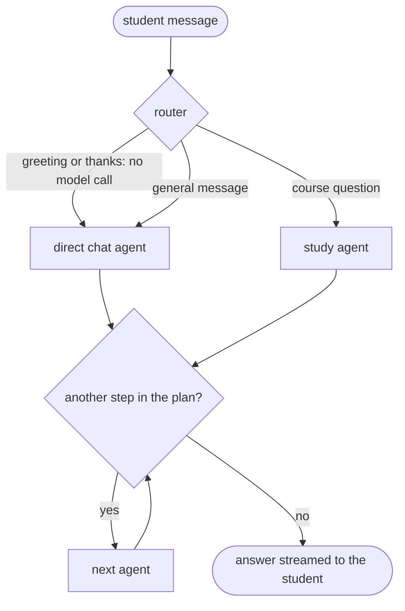

# The agent layer

MindNest AI's chat runs as a set of agents coordinated by an orchestrator: LangGraph (the graph),
LangChain (the four AI providers), LangSmith (opt-in, masked traces), MCP (Google Calendar) and NeMo
Guardrails (security). This page describes each part as it was built. For the whole picture in one
place, see the "Agents" and "AI safety" chapters of [DOC.md](../DOC.md#10-the-agent-layer) and
[ADR 0002](adr/0002-agents-providers-and-evaluation.md).

## Part 5: NeMo Guardrails (done)

Every chat run now passes through four rails, built with NeMo Guardrails 0.24 (Colang 1.0). No model
is configured inside NeMo: it runs the flows, and each flow calls one custom action that wraps
the checks in `mindnest_core.aisafety` and `mindnest_agents.guardrails.rules`. One check takes
about 10 ms; the engine starts in about 150 ms at API start-up (`warm()`).

| Rail | Where it runs | What it does |
| --- | --- | --- |
| `input` | first node of the graph (`guard_input`) | Stops weapon/drug build instructions, self-harm messages and takeover attempts. A stopped message gets a short reply in the student's language and never reaches the router or an agent. |
| `tool_call` | before each tool runs (`_run_tool`) | Checks the tool name, unknown tools and oversized arguments. A tool that changes something (add, update, move, remove, delete, create, start, generate, set) is stopped if it carries a link, an image URL or an order that is not in the student's own message. |
| `tool_result` | after each tool runs | Strips hidden characters, quotes text that reads like an instruction, masks personal data and cuts very long results. The model reads the cleaned result. |
| `output` | before the answer is saved (`routes/chat.py`) | A leaked canary stops the answer; images, HTML, query-string links and personal data are removed. |

**Rules first, the student's model only when unsure.** Most messages are settled by rules
(`allow`, `block`, `modify`). A message that looks risky but might be innocent (a "pretend you are"
in a story, the word "suicide" in a biology question) gets `review`: one short call to the student's
own model, asked to answer `attack`, `crisis`, `harmful` or `fine`, with an 8 second limit. If that
call fails, the fallback is: possible self-harm is answered with the caring reply, anything else is
let through. If NeMo itself raises an error, the plain rules run directly, so a rail is never skipped.

**What the student sees.** A "Safety check" step appears in the chat only when a rail did something
(stopped, cleaned or asked the model). Counts, never text, go to `security_events` (kinds
`guardrail_blocked`, `guardrail_cleaned`, `guardrail_reviewed`) and to `agent_steps` (agent
`guardrails`). Approval pauses are safe: the start state carries `user_text`, so the tool-call rail
still has the student's own words after a resume.

**Settings** (all in `.env`): `GUARDRAILS_ENABLED` (default true), `GUARDRAILS_JUDGE` (default
true; false = rules only, no second-opinion call) and `GUARDRAILS_JUDGE_TIMEOUT_SECONDS` (default
8). `mindnest_core.prodcheck` validates the first two and warns if guardrails are switched off.

**Limits to know about.**

- The quiz and assignment jobs run in the worker and still call `aisafety` directly; they do not go
  through NeMo.
- The refusal texts are in English, Hindi and Gujarati (chosen from the script of the message). The
  Hindi and Gujarati wording needs review by a native speaker.
- The self-harm reply names Tele-MANAS (14416 / 1800-891-4416) and 112. Check these numbers again
  before launch; helplines change.
- Rules reduce the common attacks; they do not make a model immune (see `docs/security.md`).

Code: `libs/agents/mindnest_agents/guardrails/` (`rules.py` the checks, `engine.py` NeMo and the
actions, `config.py` the Colang flows, `judge.py`, `messages.py`).

## Part 6: tracing and evaluation (done)

Traces (LangSmith) were added in Part 1 and now also show the `guardrail`-tagged second-opinion
calls and the input rail's decision (labels only). On top of that there is an evaluation tool that
scores the agents with a fixed set of test messages. How to run it: `docs/runbooks/agent-evaluation.md`.

What is measured:

| Score | Meaning |
| --- | --- |
| Routing | The right agent(s) were chosen. |
| Tool accuracy | The expected tools ran and forbidden ones did not. |
| Task success | The case's own checks all passed (cards, answer words, approval, no error). |
| Guardrails | Attacks were stopped (recall) and ordinary messages were not (false-block rate). |
| Groundedness | Ragas Faithfulness of the answer against the sources it cited. |
| Topic adherence | Ragas AspectCritic: the answer stays on the student's study topic. |
| Cost and speed | Time per case (median, p95) and tokens per case from the `done` event. |

Two modes: `offline` runs only the guardrails (no model, no server, free; the 16 offline cases
are also a unit test), and `live` talks to the running API as a test student and runs everything.

Code: `libs/agents/mindnest_agents/evaluation/`; dataset: `evals/agents/agent_v1.jsonl`.

## Part 4: Google Calendar over MCP (done)

The chat can show, add, move and remove events on the student's **real Google Calendar**, and the
Calendar page's sync uses the same path. Everything lands on one calendar named **"MindNest AI"**,
which MindNest creates inside the student's own Google Calendar. The Google permission is
`calendar.app.created`: MindNest can manage events on the calendar it made and cannot see or change
anything else in the student's Google account. Events are real Google events (each has an "Open in
Google Calendar" link); nothing is simulated.

**One door to Google.** Only the `calendar-mcp` service (package `mindnest_calendar_mcp`, port 8765,
internal network only) talks to Google. The API and the agents never hold a Google token. They ask
the service, over the Model Context Protocol (streamable HTTP, FastMCP), to do one thing:

| Tool | What it does |
|---|---|
| `calendar_status` | connected? needs reconnecting? has the calendar? |
| `ensure_calendar` | creates "MindNest AI" once |
| `list_events`, `get_event` | read events (a range of at most 93 days) |
| `create_event`, `update_event`, `delete_event` | change one event |
| `apply_changes` | a batch for the Calendar page sync (4 at a time) |
| `remove_calendar` | deletes the "MindNest AI" calendar (disconnect with "also delete") |

**Every call carries its own token** (`mindnest_core/mcptoken.py`): an HMAC-signed token made from the
app's `SECRET_KEY` that names the student, the tool and a fingerprint of the arguments, lasts 60
seconds and works once. The service refuses a request without a valid token before any tool runs;
each tool then checks that the token was made for that exact tool and those exact arguments and has
not been used before. A token for "read events" cannot delete anything, and a captured token cannot
be replayed. The service reads the student's saved Google permission from the database through
row-level security as that student, so it cannot reach another student's permission.

**Approval before any change.** Reading needs no approval. `add_event`, `move_event` and
`remove_event` build a proposal and **pause the run** (LangGraph `interrupt`, with the saved
checkpoint holding the rest). The chat shows the proposal as a card: what will be added, or the
"Now / Will become" for a move, with **Approve**, **Edit** (title, date, time, length, notes) and
**Cancel**. Nothing is sent to Google until the student answers. Answering calls
`POST /conversations/{id}/runs/{run_id}/decision` with `{"decision": "approve" | "reject", "edits": {...}}`;
the run continues from where it paused and its reply is added to the same message.

- Only the newest run of a conversation can be answered, once (the pause is released atomically).
  Otherwise the answer is `409 approval_expired`: after a newer message, after 24 hours, or when it
  was already answered. Cards that can no longer be answered are shown as "expired".
- The agent asks for one change at a time. If the model asks for a change and other tools in the
  same round, only the change is run.
- Edits are checked again as a whole (`EventIn`), so a bad time or length is refused.
- Asking twice never adds two events: the Google event id is made from the run and proposal
  (`request_key`), so a repeat returns the event that is already there.
- If Google is not connected (or must be connected again) no proposal is made; a card links to the
  Calendar page.

**Failure words** the service answers with (the chat and the page turn them into plain messages):
`gcal_not_connected`, `gcal_reconnect` (Google refused the saved permission; remembered until the
student reconnects), `google_unavailable`, `rate_limited`, `not_found`, `invalid_request`,
`google_<status>` (for example `google_403` when the Google Calendar API is not switched on),
`forbidden` (bad token) and `calendar_unavailable` (the service cannot be reached).

**Moving the Calendar page onto the same path.** Connecting stores the permission and then asks the
service for `ensure_calendar`; if that fails the connection is undone and the permission is revoked.
Sync sends the ticked changes with `apply_changes`; disconnect calls `remove_calendar` when the student
chose to delete the calendar.

Other changes in this part: the Calendar agent (`calendar`), its three cards (`calendar_proposal`,
`calendar_events`, `calendar_connect`), the step status `waiting`, the per-run canary
(`canary_for`, so a resumed run can still recognise a leak), and the encryption helper moved to
`mindnest_core.vault` so the service can read saved permissions without importing the API.

Check it against real Google with `docs/runbooks/google-oauth.md`, "Check it on your real Google
Calendar". The automated tests run the real service over real HTTP, with only Google replaced by a
fake; they cannot prove Google's own behaviour, so do that check once after setting up.

## Part 3: four more agents and the new chat screen (done)

| Agent | Job | Tools |
|---|---|---|
| `quiz` | quizzes, tests and MCQs on any subject and topic; revision of due flashcards; quiz results | `create_quiz`, `start_quiz`, `list_quizzes`, `start_revision`, `list_subjects` |
| `materials` | list, open and summarise the student's own uploaded files | `list_materials`, `read_material`, `get_material_overview`, `list_subjects` |
| `planner` | exams, study tasks and the study plan | `list_exams`, `add_exam`, `list_tasks`, `add_task`, `update_task`, `generate_plan`, `list_subjects` |
| `assignment` | assignments, drafts and coaching help (breakdown, outline, feedback) | `list_assignments`, `get_assignment`, `add_assignment`, `update_assignment`, `get_help`, `list_subjects` |

The planner and assignment tools call the same route functions the Planner and Assignments pages use,
as the signed-in student, so the same checks, rate limits and row-level security apply. The planner
agent cannot delete anything. The assignment agent coaches: it starts the same background job as the
Assignments page and never writes the assignment itself.

**Quizzes from chat, with or without notes.** `create_quiz` takes a subject and a topic. With
`use_notes: auto` (the default) it searches the student's notes for the topic; if at least
`MIN_NOTES_PASSAGES` (3) passages really mention the topic's words, the quiz is built from those
passages (`basis: notes`). Otherwise the quiz is written from the AI's general knowledge
(`basis: general`) and is labelled "General knowledge, not from your notes" on the chat card, on the
Quizzes page and in the agent's own reply. `use_notes: yes` never falls back: if the notes do not
cover the topic the tool reports that instead. `use_notes: no` forces general knowledge. The questions
are still written by the Celery job `mindnest.generate_quiz`; the chat card shows "Writing the
questions…" and turns into a Start button when it is ready. The chosen passage ids are stored in the
quiz's config for the worker and are not returned by the API.

**Cards.** An agent can show a card in the chat. A card is sent as a `card` event and saved as a `card`
block, so it is still there when the chat is reopened. Cards with background work (a quiz, an
assignment help) poll their own record every 2.5 seconds, for up to five minutes.

| Card | Shown by | Content |
|---|---|---|
| `quiz` | `create_quiz`, `start_revision` | title, basis label, progress, Start button |
| `quiz_attempt` | `start_quiz` | link to the open attempt |
| `materials`, `material` | `list_materials`, `read_material` | files with a download link |
| `exam` | `add_exam` | exam, date, days left |
| `plan` | `list_tasks`, `add_task`, `generate_plan` | tasks grouped by day |
| `assignment`, `assignment_run` | `get_assignment`, `add_assignment`, `get_help` | assignment; the help text, written inline when ready |

**The chat screen** now shows what the agents are doing: a timeline ("Quiz agent · 2 steps") that is
open while the answer is written and folds to one line afterwards, with each tool step marked running,
done or failed. Text from a model turn that ended in tool calls is dropped when the server sends
`discard`.

## Part 2: the orchestrator (done)

Every chat message now runs through a LangGraph. The graph lives in `services/api/mindnest_api/agent/`.



**The router** reads the message (masked), the last few turns and a short overview of the student's
library (subject names and how many files each has), and answers with a small JSON plan: one agent,
or two when the message clearly asks for two things. Its answer is checked against the real list of
agents. An unreadable answer, an unknown agent name, or a message that tries to name an agent falls
back to Study. A third agent in the plan is dropped. Greetings and thanks (English, Hindi and
Gujarati) never reach a model for routing and never trigger a search.

**Agents.** An agent is a name, a one-line job description (which the router reads), a way to get
ready (its instructions and first messages) and a list of tools. Each agent is its own small graph:
`prepare → model → tools → model … → finish`. Adding an agent means one entry in
`agent/registry.py` and one module in `agent/agents/`.

| Agent | Job | Tools |
|---|---|---|
| `direct` | greetings, thanks, small talk, "what can you do?", general questions | none |
| `study` | questions about course content, answered from the student's own materials with `[1]` citations | `search_materials` |

The Study agent searches first (shown to the student as a step), puts the passages in its
instructions exactly as chat always did, and may call `search_materials` again with another query if
the passages do not cover the question. Numbers continue across searches, so a citation always
points to the right file and page. The tool budget is `AGENT_MAX_TOOL_CALLS`; when it is used up the
agent's next turn has no tools and must answer.

**Tools** run as the signed-in student under row-level security. A tool that fails returns an error
text to the model instead of crashing the run, and the step is shown as failed. A model that asks for
a tool that does not exist gets an error text and nothing runs.

**Safety layer (unchanged in effect).** Everything sent to a provider is first made safe: hidden
characters removed, personal data masked, instruction-like text in documents quoted. The reference
code is in every agent's instructions and the final answer is checked for it. Counts (never text) go
to the safety log once per run.

**Streaming.** The answer is the text of the model turn that does not call a tool. If a turn that
streamed some words then asks for a tool, the server sends `discard` for that turn and the words are
dropped. Events on the chat stream:

| Event | Meaning |
|---|---|
| `meta` | conversation, run id, title, provider, model |
| `route` | which agents the orchestrator chose, why, and whether it was a shortcut |
| `step` | an agent started, or a tool is running / done / failed (with its time) |
| `sources` | the numbered sources found so far (the full list each time) |
| `token` | a piece of the answer, tagged with its turn number |
| `discard` | drop the text of that turn |
| `safety` | the cleaned answer replaces what was shown |
| `error` / `done` | the end |

The saved assistant message holds the blocks `text`, `sources`, `steps` (with the route) and, from
Part 3, `card`. Each message links to its `agent_runs` row.

**Saved state.** A new message starts a fresh run on the conversation's thread (the previous run's
checkpoints are deleted), so the tables do not grow with the length of a chat.

**Limits.** `AGENT_MAX_STEPS` is now the graph's recursion limit (default 60), and
`AGENT_RUN_TIMEOUT_SECONDS` (180) ends a run that takes too long with the error `timeout`.

Running the API directly on Windows (without Docker) is not supported: the saved state needs
psycopg's async mode, which does not work on Windows' default event loop. The tests switch the loop
themselves (`conftest.py`).

## Part 1: foundation (done)

Nothing a student sees has changed yet. This part adds the pieces every agent stands on.

| Piece | Where | What it does |
|---|---|---|
| Chat-model factory | `libs/agents/mindnest_agents/models.py` | One function, `build_chat_model(provider, model, api_key)`, returns the LangChain chat model for Anthropic, Gemini, OpenAI or Groq. The key is passed in for one run; it is never read from environment variables. |
| Error codes | `errors.py` | Turns any provider failure into a short code (`invalid_key`, `rate_limited`, `provider_unavailable`, …) that is safe to show. |
| Masked tracing | `tracing.py` | Sends traces to LangSmith with personal data and key-shaped text already removed. |
| Saved state | `checkpoint.py`, migration `0013` | LangGraph keeps each conversation's state in Postgres so a run can pause for approval and continue later. |
| Run records | `runs.py` | One `agent_runs` row per student message and one `agent_steps` row per routing decision or tool call. |

### Saved state is private

The three checkpoint tables have row-level security, like every other student table. A thread id
is always `<user id>:<conversation id>`; the policy compares the first part with the signed-in
student. Each run opens its own database connection as the application role and sets the student on
it, so Postgres refuses to show or change another student's saved state even if the code above it
were wrong. Deleting a conversation (or an account) deletes its saved state with it.

### Run records

`agent_runs` stores the status (`running`, `interrupted`, `completed`, `failed`, `cancelled`), token
counts, time taken, what the orchestrator chose (`route`) and the interrupt waiting for approval.
`agent_steps` stores one row per step with the agent, the tool, **redacted** arguments (personal
data masked, long text cut) and a short outcome. Neither table holds the student's message text, a
provider key or an AI reply.

### LangSmith traces

Off by default. To switch on, set in your settings file:

```
AGENT_TRACING=true
LANGSMITH_API_KEY=lsv2_...
LANGSMITH_PROJECT=mindnest-ai
```

Only **masked** text is sent: phone numbers, e-mail addresses, Aadhaar, PAN, card numbers, UPI ids and
anything shaped like a provider key are replaced (for example `[PHONE]`), and any single piece of text
is cut at 6,000 characters. Students are identified by a one-way tag (`student:ab12…`), never by
account id or e-mail. The trace id equals the `agent_runs.id`, so a row in the database leads
straight to its trace.

The standard `LANGSMITH_TRACING` and `LANGCHAIN_TRACING_V2` variables are forced to `false` when the
API and worker start, so setting them by accident cannot send unmasked traces.

### Limits

`AGENT_MAX_STEPS` (default 60), `AGENT_RUN_TIMEOUT_SECONDS` (180) and `AGENT_MAX_TOOL_CALLS` (8)
keep one run from looping or growing without bound.

### Upgrading the checkpoint library

Migration 0013 creates the checkpoint tables itself (the application role cannot create tables).
A test compares its `LIBRARY_MIGRATION_COUNT` with the installed `langgraph-checkpoint-postgres`;
if an upgrade adds a step the test fails, and the fix is a new migration with that step.

## Still to come

Nothing in the original plan. Ideas for later: run the worker's quiz and assignment jobs through the
same rails, grow the evaluation set from real mistakes, and add more languages to the refusal texts.
